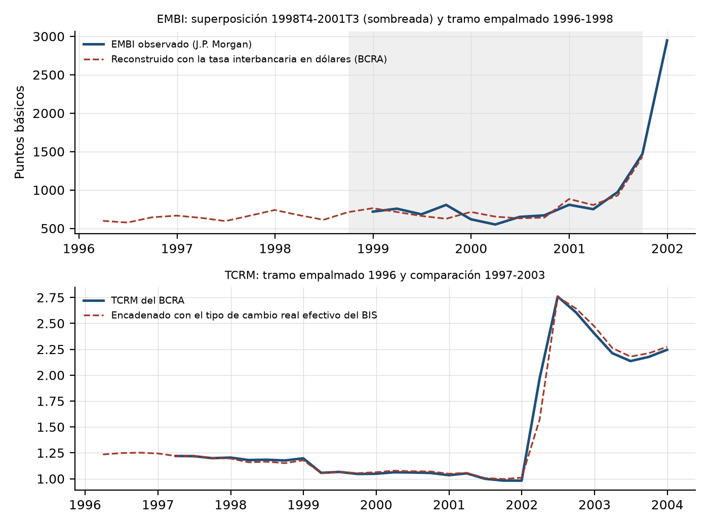

# Apéndice estadístico

Fuente de todas las tablas, salvo indicación: elaboración propia.

## A.1 Estadísticos descriptivos

Muestra efectiva de estimación, 1998T2-2025T4 (111 trimestres).

| Variable | Media | Desvío estándar | Mínimo | Máximo |
|---|---|---|---|---|
| Resultado primario (% del PIB, trimestral anualizado) | -0,95 | 3,41 | -12,53 | 6,92 |
| Crecimiento real trimestral (%) | 0,39 | 7,41 | -13,77 | 18,21 |
| EMBI (puntos básicos) | 1.559,25 | 1.612,73 | 210,22 | 6.658,98 |
| TCRM (diciembre de 2001 = 1) | 1,66 | 0,45 | 0,98 | 2,76 |
| Deuda federal bruta, rezagada (% del PIB) | 66,56 | 31,45 | 32,18 | 154,59 |
| Variación de la tasa de la FED (puntos) | -0,04 | 0,50 | -1,43 | 1,46 |
| VIX | 20,20 | 7,33 | 10,31 | 58,60 |

El máximo de la deuda federal bruta propia, 154,59%, corresponde a 2002T3, después de la devaluación de 2002. No proviene de la cifra del FMI para diciembre de 2023 (154,6%), con la que coincide por casualidad: la serie propia da 153,5% en esa fecha (Tabla 5.2).

## A.2 Empalmes de 1996-1998

La serie diaria pública del EMBI para Argentina comienza el 11 de diciembre de 1998 y el índice de tipo de cambio real multilateral del BCRA, en enero de 1997. Para completar la ventana 1996-2025, el EMBI de 1996T1-1998T3 se reconstruye con la relación EMBI = 550,3 + 1,171 × diferencial, estimada en la superposición, donde el diferencial es la tasa de préstamos interfinancieros en dólares del BCRA menos la tasa de fondos federales. La superposición termina en 2001T3 porque el corralito de diciembre de 2001 interrumpe el mercado interbancario en dólares. El TCRM de 1996 se encadena hacia atrás con las variaciones del tipo de cambio real efectivo del BIS. La Figura A.1 compara las series observadas con las reconstruidas.

| Serie | Variable puente | Superposición | n | Correlación | R² | Validación |
|---|---|---|---|---|---|---|
| EMBI | Tasa de préstamos interfinancieros en dólares (BCRA) menos tasa de fondos federales | 1998T4-2001T3 | 12 | 0,944 | 0,89 | Error típico dejando un trimestre afuera: 102 pb (desvío del EMBI: 240 pb) |
| TCRM | Tipo de cambio real efectivo amplio del BIS (invertido) | 1997T2-2025T4 | 115 | 0,923 | 0,85 | Correlación de las variaciones en 1997-2001: 0,977 |

Fuente: elaboración propia con datos del BCRA, J.P. Morgan (serie diaria publicada por Ámbito Financiero), Reserva Federal y BIS. La correlación y el R² del EMBI son de niveles trimestrales, entre el EMBI y el diferencial; los del TCRM son de variaciones trimestrales, entre el índice del BCRA y el del BIS, porque el empalme encadena variaciones.

Como la estimación empieza en 1998T2 (sección 4.5) y el modelo tiene dos rezagos, el TCRM de 1996 no entra en el SVARX y el EMBI reconstruido solo aparece en 1997T4-1998T3. El TCRM de 1996 sí entra en la variante a la manera del FMI, para calcular la depreciación real de 1997; el EMBI no se usa en esa variante.

**Validación fuera de muestra del empalme del EMBI.** Relación estimada solo con 1998T4-2000T4 y aplicada a 2001:

| Trimestre | EMBI observado | Pronóstico fuera de muestra |
|---|---|---|
| 2001T1 | 750 | 744 |
| 2001T2 | 973 | 801 |
| 2001T3 | 1469 | 1033 |

El empalme reproduce el nivel y subestima el salto de la crisis de 2001: si tiene un sesgo, atenúa la volatilidad de 1996-1998 y vuelve más conservadoras las probabilidades. Con datos desde 1999, sin empalme, los resultados casi no cambian (sección A.10).

| Trimestre | EMBI empalmado (pb) | TCRM empalmado |
|---|---|---|
| 1996T1 | 598 | 1,235 |
| 1996T2 | 576 | 1,248 |
| 1996T3 | 645 | 1,252 |
| 1996T4 | 666 | 1,244 |
| 1997T1 | 637 |  |
| 1997T2 | 595 |  |
| 1997T3 | 667 |  |
| 1997T4 | 740 |  |
| 1998T1 | 672 |  |
| 1998T2 | 612 |  |
| 1998T3 | 712 |  |

Fuente: elaboración propia.

## A.3 Propiedades de las series

**Raíz unitaria.** ADF (Dickey y Fuller, 1979; hipótesis nula: raíz unitaria) y KPSS (Kwiatkowski et al., 1992; hipótesis nula: estacionariedad), con constante. Una serie se clasifica como estacionaria solo si ADF rechaza y KPSS no rechaza al 5%, y con raíz unitaria en el caso inverso. Zivot y Andrews (1992) permiten un quiebre endógeno en el nivel. Ventana 1996-2025. Especificación: en ADF y en Zivot y Andrews, el número de rezagos de las diferencias se elige por el criterio de Akaike hasta el máximo de la regla de Schwert (1989), con constante y sin tendencia; en KPSS, con constante, el ancho de banda es el que elige el procedimiento automático de Hobijn et al. (2004). Los p-valores de KPSS se interpolan entre 0,01 y 0,10, por lo que se escriben como desigualdades en los extremos.

| Serie | ADF (p) | KPSS (p) | Clasificación | Zivot-Andrews (p) | Quiebre de Zivot-Andrews |
|---|---|---|---|---|---|
| Resultado primario | 0,580 | < 0,01 | raíz unitaria | 0,997 | 2012T3 |
| Crecimiento real | 0,053 | > 0,10 | ambigua | 0,236 | 2003T1 |
| EMBI | 0,154 | > 0,10 | ambigua | 0,084 | 2005T2 |
| TCRM | 0,249 | > 0,10 | ambigua | < 0,001 | 2001T4 |
| Deuda federal bruta | 0,094 | > 0,10 | ambigua | 0,457 | 2005T1 |
| Deuda consolidada con el BCRA | 0,396 | 0,095 | ambigua | 0,967 | 2015T3 |
| Tasa de la FED (nivel) | 0,104 | < 0,01 | raíz unitaria | 0,113 | 2007T3 |
| VIX | < 0,001 | > 0,10 | estacionaria | 0,028 | 2019T4 |

**Quiebres estructurales.** El procedimiento de Bai y Perron (2003) sobre la media de la deuda federal bruta (1996-2025), con el número de quiebres elegido por el criterio de Schwarz, encuentra 3 quiebres: 2001T4, 2006T2, 2018T1. Entran como variables binarias de escalón en el SVARX los de 2006T2 y 2018T1; el que coincide con un cambio de gobierno lo reemplazan las binarias presidenciales.

**Cointegración.** Prueba de la traza de Johansen (1991) sobre las variables en niveles (resultado primario, EMBI, TCRM y deuda), con los rezagos del VAR. El crecimiento se excluye porque es una tasa de variación. Términos determinísticos: una constante en el VAR en niveles, sin tendencia (det_order = 0 en la implementación de *statsmodels*), con el número de rezagos del VAR menos uno en las diferencias; los valores críticos son los de la traza al 5% para esa especificación. La prueba omite los quiebres y las binarias, de modo que es indicativa (Johansen et al., 2000).

| Hipótesis nula | Traza | Valor crítico 5% | Rechaza |
|---|---|---|---|
| rango = 0 | 42,7 | 47,9 | no |
| rango ≤ 1 | 22,0 | 29,8 | no |
| rango ≤ 2 | 10,9 | 15,5 | no |
| rango ≤ 3 | 3,3 | 3,8 | no |

**Binarias presidenciales.** Significancia conjunta de las siete binarias por mandato (Menem es la referencia): prueba de Wald (estadístico F) en cada ecuación y razón de verosimilitud del sistema con la corrección de Sims (1980).

| Contraste | Estadístico | Grados de libertad | p-valor |
|---|---|---|---|
| Wald, ecuación resultado primario | 2,72 | 7 | 0,014 |
| Wald, ecuación crecimiento | 1,67 | 7 | 0,127 |
| Wald, ecuación EMBI | 7,38 | 7 | < 0,001 |
| Wald, ecuación TCRM | 3,16 | 7 | 0,005 |
| Razón de verosimilitud del sistema (Sims) | 80,05 | 28 | < 0,001 |

**Coincidencia de los quiebres con los cambios de gobierno.** Los quiebres se recalculan al reestimar con otra serie o muestra. Cuando uno coincide con el inicio de un gobierno, las binarias presidenciales lo reemplazan; los que caen dentro de un mandato se conservan.

| Quiebre | Gobierno en funciones | Inicio de gobierno más cercano | Distancia (trimestres) | Tratamiento |
|---|---|---|---|---|
| 2001T4 | Duhalde | Duhalde | 0 | lo reemplazan las binarias presidenciales |
| 2006T2 | N. Kirchner | C. Fernández de Kirchner | -6 | se conserva |
| 2018T1 | Macri | A. Fernández | -7 | se conserva |

## A.4 Selección del orden del VAR

Muestra efectiva común 1998-2025 (111 trimestres) para todos los órdenes (sección 4.5). El punto de partida es el orden que elige el criterio de Schwarz entre los órdenes estables (Ivanov y Kilian, 2005); si sus residuos rechazan la ausencia de autocorrelación, se toma el menor orden mayor que no la rechaza y, si ninguno la rechaza al 5%, el orden estable con el mayor p-valor de Portmanteau.

**Deuda federal bruta (principal).** Orden del criterio de Schwarz: 1. Orden elegido: 2.

| p | AIC | BIC | HQ | Raíz máxima | Estable | Portmanteau (p) |
|---|---|---|---|---|---|---|
| 1 | 12,173 | 14,321 | 13,044 | 0,746 | sí | < 0,001 |
| 2 | 11,853 | 14,392 | 12,883 | 0,776 | sí | 0,031 |
| 3 | 11,936 | 14,865 | 13,125 | 0,862 | sí | 0,014 |
| 4 | 11,873 | 15,193 | 13,220 | 0,953 | sí | < 0,001 |
| 5 | 11,909 | 15,619 | 13,414 | 1,005 | no | < 0,001 |
| 6 | 11,828 | 15,928 | 13,491 | 1,008 | no | < 0,001 |

Con la deuda consolidada con el BCRA (extensión), la misma regla elige 1 rezago (raíz máxima 0,683, Portmanteau p = 0,147); muestra efectiva 2003-2025 (90 trimestres), desde 2002 (sección 5.2).

## A.5 Diagnósticos de los residuos

Portmanteau con 12 rezagos (autocorrelación), Jarque-Bera multivariada (normalidad), ARCH-LM con cuatro rezagos por ecuación (heterocedasticidad condicional) y estabilidad (1 = estable).

| Prueba (p-valor salvo estabilidad) | federal bruta (principal) | consolidada con el BCRA (extensión) |
|---|---|---|
| Portmanteau (12 rezagos) | 0,031 | 0,147 |
| Normalidad multivariada (p-valor) | < 0,001 | < 0,001 |
| Estable (1 = sí) | 1,000 | 1,000 |
| ARCH-LM(4) resultado primario (p-valor) | 0,960 | 0,973 |
| ARCH-LM(4) crecimiento (p-valor) | 0,833 | 0,803 |
| ARCH-LM(4) EMBI (p-valor) | 0,925 | 0,969 |
| ARCH-LM(4) TCRM (p-valor) | < 0,001 | 0,362 |

## A.6 Matriz de impacto estructural

Efecto en el mismo trimestre de un *shock* estructural de un desvío estándar (especificación principal). Los ceros son las restricciones de identificación de la sección 4.4. Los dos *shocks* del bloque cambiario y de riesgo no tienen interpretación por separado: solo se usa su efecto conjunto.

| Variable | *Shock* fiscal | *Shock* de actividad | *Shock* cambiario y de riesgo 1 | *Shock* cambiario y de riesgo 2 |
|---|---|---|---|---|
| Resultado primario | 1,316 | 0,677 | 0,000 | 0,000 |
| Crecimiento | -0,277 | 2,708 | 0,000 | 0,000 |
| EMBI | -85,360 | -22,504 | 376,484 | 0,000 |
| TCRM | 0,014 | -0,008 | -0,002 | 0,106 |

## A.7 Matrices de impacto de los ordenamientos de Cholesky

Efecto en el mismo trimestre de un *shock* de un desvío estándar, con el mismo formato que la matriz estructural (A.6). En una descomposición de Cholesky cada variable responde en el trimestre a los *shocks* de las que la preceden en el orden y no a los de las que la siguen, de modo que los ceros de cada matriz indican el orden causal. Las filas están en el orden del sistema y las columnas son el *shock* de cada variable.

**Resultado primario primero.** Orden de las variables, de la primera a la última: resultado primario, crecimiento, EMBI, TCRM.

| Variable | *Shock* del resultado primario | *Shock* del crecimiento | *Shock* del EMBI | *Shock* del TCRM |
|---|---|---|---|---|
| Resultado primario | 1,480 | 0,000 | 0,000 | 0,000 |
| Crecimiento | 0,992 | 2,535 | 0,000 | 0,000 |
| EMBI | -86,202 | 19,029 | 376,484 | 0,000 |
| TCRM | 0,009 | -0,013 | -0,002 | 0,106 |

**Resultado primario último.** Orden de las variables, de la primera a la última: crecimiento, TCRM, EMBI, resultado primario.

| Variable | *Shock* del resultado primario | *Shock* del crecimiento | *Shock* del EMBI | *Shock* del TCRM |
|---|---|---|---|---|
| Resultado primario | 1,335 | 0,540 | -0,304 | 0,164 |
| Crecimiento | 0,000 | 2,722 | 0,000 | 0,000 |
| EMBI | 0,000 | -13,696 | 386,013 | -18,427 |
| TCRM | 0,000 | -0,009 | 0,000 | 0,107 |

## A.8 Ecuación del resultado primario

Ecuación del resultado primario del VARX en forma reducida, especificación principal (MCO, 1998T2-2025T4). No se muestran la constante, las variables binarias estacionales ni las de los quiebres. Los errores estándar y los p-valores son los de MCO y se informan como referencia: con regresores que pueden tener raíz unitaria su distribución no es la estándar (Sims et al., 1990), por lo que la inferencia del texto usa los intervalos del *bootstrap*. El coeficiente de la deuda rezagada es el efecto de impacto sobre el resultado primario trimestral. El multiplicador de largo plazo, que descuenta los rezagos propios del resultado primario, es 0,079, con un intervalo de 90% de [0,062; 0,147].

| Regresor | Coeficiente | Error estándar | p-valor |
|---|---|---|---|
| Variación de la tasa de la FED, rezago 0 | 0,6314 | 0,5069 | 0,213 |
| Variación de la tasa de la FED, rezago 1 | -0,3595 | 0,5962 | 0,547 |
| Variación de la tasa de la FED, rezago 2 | -0,1902 | 0,5150 | 0,712 |
| VIX | 0,0128 | 0,0324 | 0,693 |
| Binaria presidencial: De la Rúa | -0,3436 | 0,9390 | 0,714 |
| Binaria presidencial: Duhalde | -2,3351 | 1,3219 | 0,077 |
| Binaria presidencial: N. Kirchner | -1,4522 | 1,4445 | 0,315 |
| Binaria presidencial: C. Fernández de Kirchner | -1,8334 | 1,5204 | 0,228 |
| Binaria presidencial: Macri | -3,5846 | 1,5567 | 0,021 |
| Binaria presidencial: A. Fernández | -4,9172 | 1,9016 | 0,010 |
| Binaria presidencial: Milei | -1,6205 | 2,0570 | 0,431 |
| Deuda federal bruta, rezago 1 (reacción fiscal de impacto) | 0,0466 | 0,0208 | 0,025 |
| Resultado primario, rezago 1 | 0,1634 | 0,1036 | 0,115 |
| Crecimiento, rezago 1 | 0,0629 | 0,0588 | 0,285 |
| EMBI, rezago 1 | -0,0005 | 0,0004 | 0,161 |
| TCRM, rezago 1 | 1,7254 | 1,4642 | 0,239 |
| Resultado primario, rezago 2 | 0,2493 | 0,1113 | 0,025 |
| Crecimiento, rezago 2 | 0,1330 | 0,0544 | 0,015 |
| EMBI, rezago 2 | -0,0001 | 0,0004 | 0,840 |
| TCRM, rezago 2 | -0,4177 | 1,4189 | 0,768 |

## A.9 Resultados completos de la especificación principal

Estimación central con los parámetros de MCO y 20.000 trayectorias (error de Monte Carlo de 0,3 puntos en la probabilidad de 2031); intervalos de Hall con 1.000 réplicas de parámetros y 1.000 trayectorias cada una. Autovalor máximo del VAR: 0,776.

| Medida | Estimación central | Intervalo de 90% |
|---|---|---|
| No estabilización 2031, métrica anual (%) | 27,7 | [20,6; 34,7] |
| No estabilización 2035, métrica anual (%) | 29,0 | [25,0; 36,1] |
| No estabilización 2031, métrica anual con el resultado primario simulado (%) | 29,7 | [23,5; 37,3] |
| Probabilidad de que la deuda de 2031 supere a la de 2029 (%) | 20,0 | [17,3; 26,7] |
| No estabilización 2031, definición operativa del FMI (%) | 3,1 | [0,0; 6,3] |
| No estabilización 2035, definición operativa del FMI (%) | 5,1 | [0,0; 10,2] |
| No estabilización 2031, definición operativa del FMI, resultado primario simulado (%) | 4,8 | [0,0; 9,4] |
| No estabilización 2031, lectura literal del recuadro 3 del FMI (%) | 0,0 | [0,0; 0,0] |
| No estabilización 2035, lectura literal del recuadro 3 del FMI (%) | 0,9 | [0,0; 1,8] |
| Deuda mediana 2031 (% del PIB) | 52,9 | [51,8; 55,2] |
| Deuda media 2035 (% del PIB) | 45,0 | [40,7; 51,0] |
| Ancho del abanico 2031 (p5-p95) | 40,5 | [32,4; 54,5] |
| Varianza 2035: fiscal (%) | 1,6 | [0,1; 4,6] |
| Varianza 2035: actividad (%) | 10,7 | [1,6; 24,1] |
| Varianza 2035: cambiario y de riesgo (%) | 28,3 | [7,8; 42,6] |
| Varianza 2035: externo, FED y VIX (%) | 59,4 | [40,3; 88,3] |
| Varianza 2035: solo VIX, mismo denominador (%) | 113,2 | [51,6; 222,5] |
| Varianza 2035: solo tasa de la FED (%) | 13,3 | [2,9; 55,6] |
| Varianza 2035: tasa de la FED, solo efecto directo en la identidad (%) | 7,6 | [3,7; 29,1] |
| Varianza 2035: tasa de la FED, efecto indirecto (diferencia) (%) | 5,7 | [-6,9; 36,6] |
| Varianza total de la deuda 2035 (puntos del PIB al cuadrado) | 441,0 | [112,2; 1.149,7] |
| Suma de las varianzas de los cuatro bloques | 606,1 | [125,4; 1.709,0] |
| No fiscal menos fiscal (puntos) | 96,8 | [90,8; 99,8] |
| FED, nivel 0,50 pp más alto: diferencia en la probabilidad 2035 (pp) | 1,9 | [0,3; 3,2] |
| FED, nivel 0,50 pp más alto: diferencia en la deuda media 2035 (pp del PIB) | 2,0 | [0,4; 3,2] |
| FED, senda 2022-2025: diferencia en la probabilidad 2031 (pp) | 6,7 | [0,6; 12,8] |
| FED, senda 2022-2025: diferencia en la probabilidad 2035 (pp) | 18,4 | [6,3; 29,1] |
| FED, senda 2022-2025: diferencia en la deuda media 2035 (pp del PIB) | 19,3 | [-0,3; 31,3] |
| FED, senda 2022-2025: diferencia en la probabilidad 2035, definición operativa del FMI (pp) | 17,1 | [0,6; 32,6] |

## A.10 Robustez completa

Entre corchetes, intervalos de 90%: de Hall, salvo las participaciones y varianzas y la diferencia entre *shocks* no fiscales y fiscal, que usan percentiles simples de las réplicas. Las columnas de la definición operativa del FMI usan la reconstrucción de la sección 4.6: los impulsores del escenario en el año final más el *shock* promedio de cada trayectoria, sin variación del tipo de cambio real ni ajuste *stock*-flujo (FMI, 2022, recuadro 3). La columna de la deuda de la senda de la FED se muestra con dos decimales para distinguir los intervalos que tocan el cero. «No se informa»: más de 1% de las réplicas (10% en la columna del reparto de la varianza) tiene trayectorias explosivas que dominan la media de la deuda. Todas las especificaciones usan los mismos números aleatorios, de modo que las diferencias entre filas no provienen del sorteo. Las filas a la manera del FMI no tienen intervalo porque ese procedimiento no estima parámetros. Fuente de la última fila: FMI (2026, anexo II, cuadro 7 y párrafo 9).

| Especificación | No estabilización 2031, métrica anual (%) | No estabilización 2035, métrica anual (%) | No estabilización 2031, definición operativa del FMI (%) | No estabilización 2035, definición operativa del FMI (%) | Ancho 2031 | No fiscal menos fiscal (puntos) | Senda de la FED: probabilidad 2035 (pp) | Senda de la FED: deuda 2035 (pp) |
|---|---|---|---|---|---|---|---|---|
| Principal (deuda federal bruta) | 27,7 [20,6; 34,7] | 29,0 [25,0; 36,1] | 3,1 [0,0; 6,3] | 5,1 [0,0; 10,2] | 40,5 | 96,8 [90,8; 99,8] | 18,4 [6,3; 29,1] | 19,29 [-0,31; 31,34] |
| Deuda consolidada con el BCRA | 31,1 [27,6; 41,5] | 35,0 [32,3; 49,8] | 11,0 [2,7; 20,2] | 17,3 [7,4; 32,3] | 55,2 | no se informa | 19,2 [3,2; 33,8] | no se informa |
| Resultado primario con rentas de la propiedad | 28,5 [22,3; 36,0] | 29,3 [25,8; 36,5] | 2,9 [0,0; 5,8] | 5,5 [0,0; 10,9] | 40,1 | 99,5 [92,0; 99,8] | 20,0 [9,6; 31,6] | 21,30 [3,55; 34,67] |
| Canal de tasas en pesos | 29,5 [24,3; 36,5] | 34,9 [31,6; 44,1] | 9,0 [2,7; 17,0] | 17,4 [9,7; 32,3] | 51,6 | 98,9 [94,5; 100,0] | 22,5 [7,7; 38,0] | 33,72 [-21,30; 61,03] |
| Sin retroalimentación de la deuda | 27,2 [22,0; 34,1] | 25,6 [20,6; 31,7] | 1,3 [0,0; 2,7] | 0,3 [0,0; 0,6] | 38,1 | 95,1 [88,1; 99,6] | 8,3 [5,6; 10,9] | 13,04 [7,79; 18,36] |
| Un rezago (criterio de Schwarz) | 29,4 [27,7; 39,2] | 31,0 [27,2; 40,6] | 3,9 [0,0; 7,7] | 7,3 [0,0; 14,4] | 38,5 | 99,9 [90,7; 99,9] | 21,7 [8,3; 33,3] | 24,25 [-7,44; 41,22] |
| Tres rezagos | 25,9 [16,2; 32,5] | 27,5 [22,7; 34,6] | 2,5 [0,0; 5,1] | 3,7 [0,0; 7,4] | 38,1 | 91,6 [80,2; 99,6] | 17,5 [8,6; 28,6] | 17,29 [8,14; 28,41] |
| Cholesky, resultado primario primero | 27,7 [20,5; 34,8] | 29,0 [25,0; 36,2] | 3,1 [0,0; 6,3] | 5,1 [0,0; 10,2] | 40,5 | 85,6 [72,3; 99,5] | 18,4 [6,2; 29,0] | 19,29 [0,05; 31,35] |
| Cholesky, resultado primario último | 27,7 [20,3; 34,8] | 29,0 [24,7; 36,2] | 3,1 [0,0; 6,3] | 5,1 [0,0; 10,2] | 40,5 | 99,4 [93,9; 99,8] | 18,4 [6,2; 29,3] | 19,29 [0,09; 31,42] |
| Elasticidad cíclica 0 | 27,7 [20,5; 34,8] | 29,0 [25,0; 36,2] | 3,1 [0,0; 6,3] | 5,1 [0,0; 10,2] | 40,5 | 85,6 [72,3; 99,5] | 18,4 [6,2; 29,0] | 19,29 [0,05; 31,35] |
| Elasticidad cíclica 0,5 | 27,7 [20,7; 34,8] | 29,0 [24,9; 36,1] | 3,1 [0,0; 6,3] | 5,1 [0,0; 10,2] | 40,5 | 99,4 [88,0; 99,7] | 18,4 [6,4; 29,2] | 19,29 [0,10; 31,35] |
| Sin los *shocks* de 2001T4-2005T3 | 31,6 [27,6; 40,5] | 32,8 [29,6; 41,3] | 3,8 [0,0; 7,5] | 6,7 [0,0; 13,3] | 42,7 | 97,1 [91,1; 99,8] | 19,2 [7,6; 30,5] | 20,58 [0,00; 33,66] |
| Solo EMBI observado (datos desde 1999, sin empalme) | 29,5 [22,5; 36,7] | 30,7 [27,4; 38,2] | 3,6 [0,0; 7,2] | 5,6 [0,0; 11,2] | 42,1 | 95,7 [88,9; 99,8] | 18,0 [5,6; 28,3] | 19,69 [-1,86; 32,64] |
| Datos desde 2004 | 31,1 [26,8; 39,3] | 32,2 [23,7; 42,0] | 6,2 [0,0; 12,5] | 4,9 [0,0; 9,8] | 48,4 | 90,3 [83,4; 100,0] | 17,5 [-1,9; 31,5] | no se informa |
| Sin variables binarias de quiebre | 27,1 [22,1; 33,0] | 27,4 [22,9; 33,1] | 2,3 [0,0; 4,7] | 2,3 [0,0; 4,6] | 38,5 | 93,9 [88,2; 99,8] | 17,0 [5,3; 25,1] | 15,69 [1,21; 24,47] |
| Sin variables binarias presidenciales | 31,8 [25,2; 36,3] | 31,1 [26,9; 35,9] | 6,2 [0,2; 11,9] | 8,3 [0,3; 16,4] | 47,1 | 77,9 [67,3; 99,4] | 9,7 [3,2; 16,5] | 9,24 [-0,19; 17,06] |
| Ajuste stock-flujo en cero | 25,3 [18,2; 32,3] | 22,4 [18,0; 29,0] | 2,2 [0,0; 4,5] | 3,0 [0,0; 6,0] | 35,7 | 95,9 [89,4; 99,8] | 15,3 [4,4; 24,5] | 14,40 [1,22; 23,46] |
| λ = 0,15 | 27,0 [19,4; 34,2] | 26,9 [22,3; 33,4] | 1,8 [0,0; 3,6] | 1,7 [0,0; 3,4] | 37,0 | 96,0 [89,3; 99,7] | 11,1 [2,3; 18,0] | 11,21 [0,45; 18,84] |
| λ = 0,40 | 28,3 [21,8; 35,4] | 30,5 [26,7; 37,9] | 4,8 [0,0; 9,3] | 8,1 [0,0; 15,9] | 43,7 | 97,3 [91,9; 99,9] | 23,0 [10,1; 36,2] | 26,60 [-3,06; 43,49] |
| Escenario del FMI de 2025 | 25,7 [18,1; 32,7] | 22,9 [18,0; 29,3] | 0,9 [0,0; 1,8] | 2,0 [0,0; 3,9] | 38,0 | 96,4 [90,1; 99,8] | 12,0 [2,6; 19,6] | 12,01 [0,04; 20,27] |
| Parámetros corregidos por sesgo (Kilian, 1998) | 29,1 [20,8; 35,0] | 31,4 [26,5; 38,4] | 6,0 [0,0; 11,5] | 10,8 [0,0; 21,2] | 50,0 | 93,6 [78,1; 99,8] | 18,8 [5,1; 32,5] | 24,95 [-11,58; 45,43] |
| *Shocks* a la manera del FMI, deuda federal bruta | 24,1 | 20,6 | 29,1 | 19,1 | 148,4 | no aplica | no aplica | no aplica |
| *Shocks* a la manera del FMI, deuda consolidada | 26,2 | 19,4 | 16,1 | 7,3 | 63,4 | no aplica | no aplica | no aplica |
| FMI (2026), deuda federal bruta | 1,0 | menos de 3 | 1,0 | menos de 3 | 71,5 | no aplica | no aplica | no aplica |

