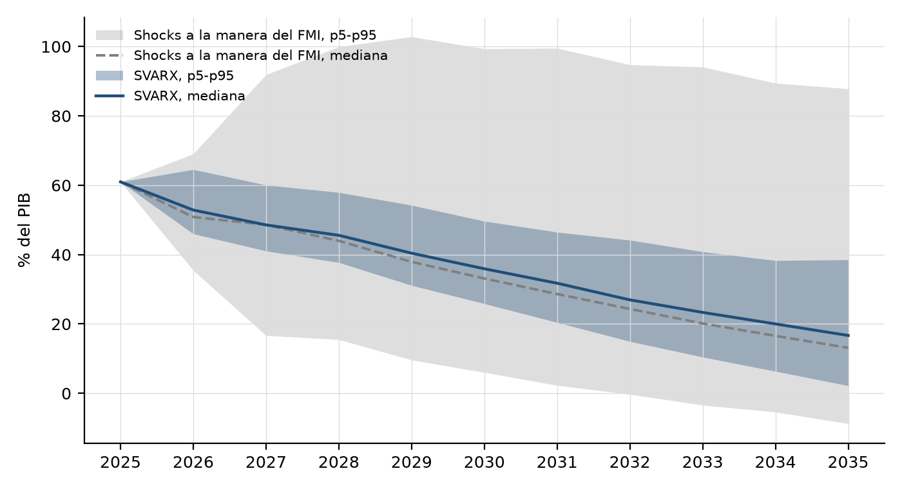
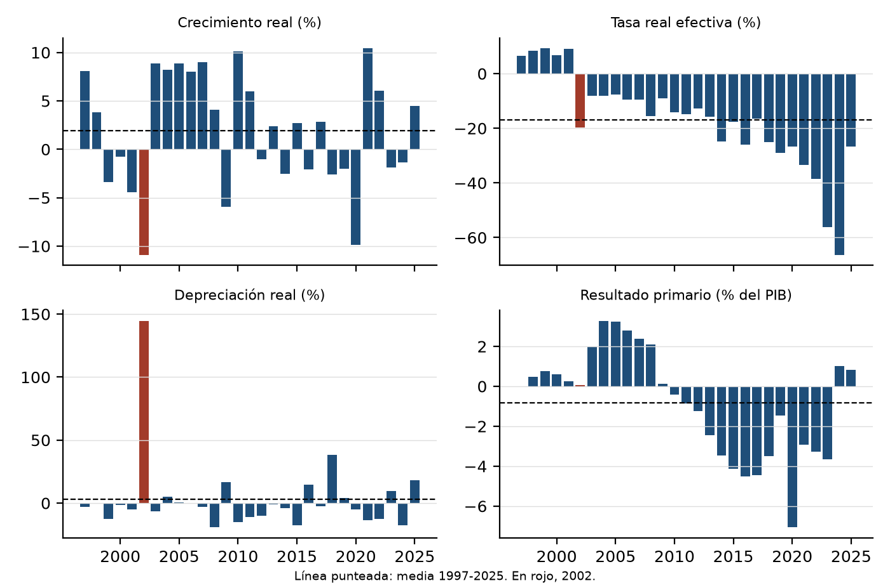

# 7. Discusión

## 7.1 Qué cambia respecto del diagnóstico del FMI

El FMI (2026) concluye que la deuda argentina es sostenible pero no con alta probabilidad, y estima en alrededor de 99% la probabilidad de que se estabilice en el mediano plazo. Con el mismo escenario base, esta tesis estima una probabilidad de no estabilización de 25,2% en 2031, con un intervalo de 19,0% a 27,7%. La diferencia no viene de supuestos más pesimistas sobre crecimiento, superávit o tasas, porque el escenario es el mismo. Tampoco se la puede atribuir a una causa única. Las robusteces del Capítulo 6 descartan algunas: no la explican el perímetro (con la deuda del Tesoro sola la probabilidad es casi igual), ni el punto de partida (partiendo de la deuda consolidada neta del FMI baja a 22,8%), ni la identificación de los *shocks*, que no altera la probabilidad. Con un procedimiento de *shocks* a la manera del FMI aplicado a los datos de esta tesis, la probabilidad es de 23,7%, del mismo orden que la del SVARX, y el ancho del abanico es de 114 puntos, contra 71,5 del FMI. Ese procedimiento no reproduce la cifra del FMI, de modo que la tesis no puede atribuir la diferencia ni al método ni a los datos: el FMI no publica la historia con la que genera sus *shocks* para Argentina, y los perímetros también difieren (deuda consolidada neta que parte de 61,0% del PIB, contra deuda federal bruta que parte de 80,3%). Lo que la tesis puede afirmar es que, con esta implementación y las series argentinas de 1996-2025, la probabilidad de no estabilización es un orden de magnitud mayor que la que informa el FMI con los dos procedimientos usados.

A diez años, la probabilidad es algo menor (22,3%) pero sigue muy por encima del umbral. La métrica del FMI pregunta si el ajuste del escenario base alcanza para poner la deuda en una senda descendente (FMI, 2021, anexo VI, nota 9). En una de cada cuatro o cinco trayectorias, ese ajuste no alcanza, incluso diez años después.

## 7.2 Por qué el abanico es más angosto y, aun así, la probabilidad es mayor

El ancho del abanico de esta tesis en 2031 es de 35,3 puntos del PIB, contra 71,5 del FMI. Parte de la diferencia es de escala: la deuda de partida es 61,0% en un caso y 80,3% en el otro, y en proporción a ella los anchos son de 0,58 y 0,89. La variante con *shocks* a la manera del FMI (sección 6.6) permite separar el resto, porque usa los mismos datos, la misma identidad y la misma métrica, y cambia solo la forma de generar los *shocks*. Con ella, el ancho es de 114 puntos (Figura 7.1). El ancho depende, entonces, de cómo se generan los *shocks*, y no del perímetro: con el SVARX, la deuda bruta y la neta dan anchos casi iguales.

**Qué ensancha el abanico del procedimiento del FMI.** La Tabla 7.1 repite esa variante quitando el año 2002 o fijando cada impulsor en su media histórica.

**Tabla 7.1. Diagnóstico de la variante con *shocks* a la manera del FMI (deuda neta)**

| Variante | No estabilización 2031 | No estabilización 2035 | Ancho del abanico 2031 |
|---|---|---|---|
| Todos los años, 1997-2025 | 23,7% | 19,7% | 114,0 |
| Sin el año 2002 | 22,9% | 19,2% | 87,1 |
| Depreciación real en su media | 21,3% | 18,1% | 92,0 |
| Tasa real efectiva en su media | 16,6% | 12,2% | 73,5 |
| Crecimiento en su media | 27,4% | 20,7% | 98,4 |
| Resultado primario en su media | 23,7% | 19,2% | 116,5 |

Fuente: elaboración propia. 20.000 trayectorias por variante.

Un solo año, 2002, aporta casi un cuarto del ancho: la depreciación real de ese año (145%) aparece, con probabilidad uno en catorce, en cada bloque de dos años sorteado. La probabilidad de no estabilización depende sobre todo de la tasa real efectiva (Figura 7.2). Esa tasa pasó de valores positivos durante la convertibilidad (entre 6% y 9% en 1997-2001) a valores muy negativos con la inflación posterior (-56% en 2023 y -66% en 2024). El procedimiento del FMI mide los *shocks* como desvíos respecto de una única media para todo el período, de -17%. Así, un año como 1999 cuenta como un *shock* de 26 puntos de tasa real, y puede aparecer en 2031 junto con cualquier otro año de la muestra, aunque correspondan a regímenes monetarios distintos. Es el problema que el FMI y el Mecanismo Europeo de Estabilidad (2023) señalan como desafío de su método: que la historia usada para generar el abanico sea representativa del futuro.

**Qué hace distinto el SVARX.** El SVARX trata los cambios de régimen con las variables binarias de los quiebres estructurales (2001, 2006 y 2018) y separa lo que la dinámica del sistema permite anticipar de lo que es sorpresa: solo remuestrea las sorpresas, que son menores que los desvíos respecto de una media de largo plazo. La tasa en dólares, por su parte, se reprecia gradualmente, a medida que vence la deuda. Por eso el abanico es más angosto. Que la probabilidad de no estabilización sea aun así alta indica que la métrica no depende tanto de la dispersión total como de la frecuencia de años en los que una depreciación real o una suba del riesgo país elevan el resultado primario necesario por encima del previsto. Esta tesis no aísla qué parte de ese resultado se debe a la persistencia de los *shocks*; queda como hipótesis para trabajo futuro.

## 7.3 El papel del superávit primario

La reacción fiscal estimada es positiva (0,051, con un intervalo de 0,010 a 0,103): en 1998-2025, el resultado primario respondió a la deuda, en línea con la condición de Bohn (1998). Ese coeficiente es el efecto de impacto sobre el resultado primario trimestral; teniendo en cuenta los rezagos del propio resultado primario, el multiplicador de largo plazo de la estimación por mínimos cuadrados es de alrededor de 0,19, una estimación puntual sin intervalo. La tesis no traduce esa reacción en un diferencial entre tasa y crecimiento que la deuda pueda tolerar.

El contraste de suficiencia de la sección 6.3 mide si el superávit alcanza. Para que la probabilidad de no estabilización en 2031 baje al 1% que estima el FMI para Argentina, el resultado primario de todos los años tendría que subir unos 4,75 puntos, hasta 7,05% del PIB en 2031, casi el doble del máximo de las últimas tres décadas (3,6% en 2004). El superávit es necesario, y el escenario base del FMI se apoya en él, pero en el rango observado no alcanza para llevar la probabilidad a la cifra del FMI. Con 58% de la deuda en moneda extranjera, la identidad hace que una depreciación real cambie el cociente de deuda aunque las cuentas fiscales estén en orden (Calvo et al., 2003); cuánto del riesgo simulado viene de esa fuente depende de la descomposición de la varianza, que no es robusta.

La descomposición de la varianza apunta en la misma dirección, con el bloque cambiario y de riesgo como el mayor componente en la estimación central, pero no es robusta: depende de cómo se identifica el *shock* fiscal y de la muestra. Esta tesis no puede afirmar con el nivel de confianza fijado que los *shocks* cambiarios y de riesgo dominen a los fiscales. Sí puede afirmar que el superávit, en el rango observado, no basta.

## 7.4 El *shock* de la FED

H2 queda respaldada solo en parte. Repetir las variaciones de la tasa de la FED de 2022-2025, que dejan su nivel 3,82 puntos por encima del base desde 2029, suma 13 puntos de probabilidad de no estabilización en 2035, con un intervalo de 1 a 25 puntos. El efecto sobre la probabilidad cumple el criterio al 90%, pero el efecto sobre la deuda esperada no lo cumple, ninguno resiste la corrección por contrastes múltiples, y en las respuestas al impulso los canales que nombra la hipótesis (riesgo, tipo de cambio real, crecimiento) no se distinguen del azar. Tres quintos del efecto sobre la deuda vienen del mayor costo de refinanciar la deuda en dólares, que el modelo incorpora por construcción a través de la identidad. Esto no quiere decir que los canales indirectos no existan: Uribe y Yue (2006) y Canova (2005) los documentan con paneles y muestras más largas. Quiere decir que una sola serie argentina de 111 trimestres no alcanza para medirlos.

## 7.5 Diálogo con la literatura

- **Balance patrimonial.** Levy Yeyati y Sturzenegger (2023) encuentran que una devaluación real de 20% casi no modifica el patrimonio neto del sector público argentino, porque el mayor costo de la deuda en dólares se compensa con más recaudación de bienes transables. Esta tesis mide otro objeto, el cociente de deuda. En la estimación central, el bloque cambiario y de riesgo es el mayor componente de la varianza de ese cociente, aunque la descomposición no es robusta y no permite afirmar que domine al fiscal. Si ese peso se confirmara, las dos conclusiones serían compatibles: el cociente de deuda puede no estabilizarse aunque el patrimonio neto se mantenga, y por eso Rodríguez (2023) advierte que el cociente es una medida engañosa después de un salto cambiario.
- **Tasa y crecimiento.** Blanchard (2019) muestra que, cuando la tasa de interés es menor que el crecimiento, la deuda se licua sin necesidad de superávit. El escenario del FMI tiene esa propiedad durante toda la década. Los resultados de esta tesis indican que, aun así, la licuación no garantiza la estabilización cuando una parte grande de la deuda está en moneda extranjera.
- **Fatiga fiscal.** Ghosh et al. (2013) sostienen que la respuesta del superávit se debilita con deuda alta; Everaert y Jansen (2018) no encuentran ese patrón de manera robusta. Esta tesis estima una regla lineal y no puede contrastar la fatiga; si existiera, el contraste de suficiencia sería todavía más desfavorable al superávit.

## 7.6 Limitaciones

- **Escenario base.** Todos los resultados están condicionados al escenario del FMI, que supone una tasa real efectiva negativa durante toda la década y un superávit sostenido. Si la desinflación es más rápida, la licuación se reduce.
- **Perímetro del escenario.** La tasa efectiva, el ajuste stock-flujo y la inflación relativa del FMI corresponden a la deuda bruta del gobierno federal y se aplican a la deuda consolidada neta. Con el ajuste stock-flujo en cero, la probabilidad baja (22,0% en 2031) pero las conclusiones no cambian.
- **FGS.** La deuda neta no descuenta los títulos en poder del FGS ni de otros organismos públicos. La ANSES no publica una serie histórica de la cartera del FGS por tipo de activo (Capítulo 5); hay datos anuales de la deuda en manos de organismos del sector público desde 2004, que no se usaron para descontar porque no cubren todo el período de estimación ni separan al FGS. Partir de la deuda del FMI, que sí descuenta el FGS, no cambia las conclusiones.
- **Persistencia.** La estimación central usa coeficientes corregidos por sesgo con un autovalor máximo de 0,9998, casi una raíz unitaria. Esa persistencia eleva las probabilidades de no estabilización, y los intervalos percentiles no quedan centrados en la estimación central, que se ubica cerca de su límite superior.
- **Resultado primario.** Incluye las rentas de la propiedad, entre ellas las utilidades del BCRA. Sin ellas, la probabilidad de no estabilización es de 23,4% en 2031 y 19,6% en 2035.
- **Autocorrelación residual y remuestreo.** La prueba de Portmanteau rechaza la ausencia de autocorrelación (p = 0,036), y los *shocks* se remuestrean como independientes entre trimestres. Los órdenes que podrían eliminarla son inestables.
- **Tamaño de la muestra.** Cada ecuación tiene unos 25 regresores para 111 trimestres. Eso explica los intervalos amplios de la descomposición de la varianza y de los efectos de la FED.
- **Cambios de régimen.** Los quiebres solo mueven el nivel de las ecuaciones, no sus coeficientes, y el régimen fiscal y monetario posterior a 2024 casi no está en la muestra. La simulación supone que la dinámica de 1998-2025 sigue vigente.
- **Identificación.** La descomposición de la varianza, pero no la probabilidad de no estabilización, depende de la elasticidad cíclica de 0,25, estimada para la OCDE, y del supuesto de que el resultado primario no responde en el trimestre al tipo de cambio.
- ***Shock* de la FED.** Se usa la variación observada de la tasa y no un *shock* monetario identificado con datos de alta frecuencia, y el VIX no responde a la FED en la simulación.
