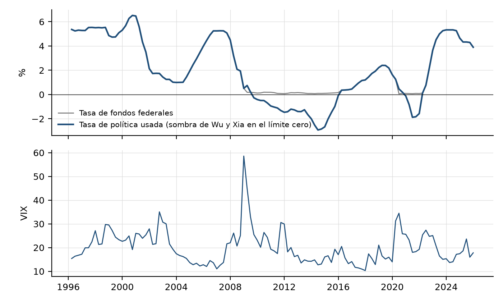

# Informe: construcción de los datos (detalle completo)

Documento interno del grupo, no forma parte de la tesis. Es la versión completa del Capítulo 5, con archivos, columnas, banderas y controles de cada serie. El Capítulo 5 de la tesis es un resumen de este informe.

Este capítulo documenta cada serie del modelo: qué mide, de dónde sale, qué transformaciones se le aplicaron y por qué. Todas las series cubren la ventana 1996T1-2025T4 (120 trimestres). Los primeros trimestres se usan como condiciones iniciales de los rezagos (la variación de la tasa de la FED entra con dos rezagos y los órdenes de hasta seis rezagos se comparan sobre una muestra común; Lütkepohl, 2005, sec. 4.3; Capítulo 4), de modo que las ecuaciones se estiman con 1998T2-2025T4 (111 observaciones). Dos series no tienen dato directo publicado en toda la ventana y se completan con empalmes documentados y validados: el EMBI de 1996T1-1998T3 y el TCRM de 1996 (secciones 5.6.1 y 5.6.2; Apéndice, sección A.2, y Figura A.1). La especificación principal usa la deuda federal bruta, el perímetro del análisis de sostenibilidad del FMI (2026, anexo II); la deuda consolidada con el BCRA es una extensión. Todas las cifras que aparecen aquí se recalcularon desde los archivos del repositorio citados en cada sección. Cuando una serie tiene una limitación, se declara junto con la dirección probable de su sesgo.

## 5.1 Resumen de las series

| Variable del modelo | Rol (Capítulo 4) | Archivo | Fuente | Cobertura real |
|---|---|---|---|---|
| Deuda federal bruta (% PIB) | Especificación principal: rezagada en las ecuaciones y acumulada en la simulación | `datos/procesados/deuda_consolidada_neta_nominal_1996_2025.csv` (`bruta_federal_pib`) | MECON, Informe de Deuda 31/12/2025 | 1996T1-2025T4 (6 trimestres de 1996-1997 interpolados, fuera de la estimación) |
| Deuda consolidada con el BCRA, tenencia del BCRA a valor nominal (% PIB) | Extensión: el mismo rol | `datos/procesados/deuda_consolidada_neta_nominal_1996_2025.csv` (`deuda_consolidada_neta_nominal_pib`) | MECON y BCRA | 1996T1-2025T4, sin FGS; nominal en 80 de 120 trimestres (ver 5.3.4) |
| Deuda neta, variante piso y valor de libros (% PIB) | Series alternativas, no usadas en la estimación | `deuda_consolidada_neta_nominal_1996_2025.csv` (`deuda_consolidada_neta_nominal_piso_pib`), `datos/procesados/deuda_consolidada_neta_1996_2025.csv` | MECON y BCRA | 1996T1-2025T4 |
| Pasivos remunerados del BCRA | Componente | `deuda_consolidada_neta_1996_2025.csv` | API BCRA v4.0 | 1996T1-2025T4 (sin swap del PBoC) |
| Deuda del Tesoro en poder del BCRA | Componente | `deuda_consolidada_neta_1996_2025.csv` | BCRA, Balance histórico; MECON para las Letras a valor nominal | 1996T1-2025T4 |
| Depósitos del Tesoro en el BCRA | Componente | `deuda_consolidada_neta_1996_2025.csv` | API BCRA v4.0, id 1264 | 1996T1-2025T4 |
| Resultado primario (% PIB, flujo trimestral anualizado) | Endógena | `datos/procesados/resultado_primario_1996_2025.csv` (`pb_pib_trim_sin_rentas`, definición principal en las dos especificaciones; `pb_pib_trim` con rentas, robustez) | MECON, Secretaría de Hacienda, esquema Ahorro-Inversión-Financiamiento (datos.gob.ar, dataset 379) | 1996T1-2025T4, mensual, sin desagregación |
| PIB real y crecimiento | Endógena | `datos/procesados/pib_real_empalme_indec_1996_2003.csv` y `datos/dataset_consolidado_1996_2025.csv` | INDEC, Oferta y Demanda Globales | 1996-2003 base 1993 empalmada a base 2004; 2004-2025 directo |
| EMBI (riesgo país, diferencial del índice EMBI de J.P. Morgan para Argentina) | Endógena | `datos/dataset_consolidado_1996_2025.csv` (columnas `EMBI` y `EMBI_fuente`) | J.P. Morgan, serie diaria publicada por Ámbito Financiero desde el 11 de diciembre de 1998; 1996T1-1998T3, tasa de préstamos interfinancieros en dólares del BCRA menos la tasa de fondos federales | 1996T1-2025T4 (11 trimestres empalmados, sección 5.6.1) |
| TCRM (tipo de cambio real multilateral) | Endógena | `datos/dataset_consolidado_1996_2025.csv` (columnas `TCRM` y `TCRM_fuente`) | BCRA, `ITCRMSerie.xlsx`, desde enero de 1997; 1996, tipo de cambio real efectivo amplio del BIS | 1996T1-2025T4 (4 trimestres encadenados, sección 5.6.2) |
| Tasa de la Fed (con tasa sombra) | Exógena | `datos/procesados/tasa_fed_trimestral_1996_2025.csv` | FRED y Atlanta Fed | 1996T1-2025T4 |
| VIX | Exógena | `datos/procesados/instrumentos_1996_2025.csv` | Yahoo Finance, ^VIX | 1996T1-2025T4 |
| PIB nominal de cuatro trimestres | Denominador | `deuda_consolidada_1996_2025.csv` (`pib_4t_mm`) | INDEC | 1996T1-2025T4 (32 trimestres empalmados) |

Ninguna serie fiscal ni de deuda sale de un diccionario escrito a mano. La deuda es el cociente entre stocks en pesos tomados de los informes del MECON y el PIB nominal. El resultado primario se lee de las planillas mensuales de Hacienda y el PIB real de 1996-2003 se empalma con las series publicadas por INDEC. Todas las series que entran al sistema son trazables a archivos publicados y reproducibles con los scripts de `codigo/ingesta_datos/`; los dos empalmes de 1996-1998 los produce `codigo/ingesta_datos/empalme_embi_tcrm_1996_1998.py`, que descarga las series puente, guarda las descargas en `datos/crudos/empalmes/` y escribe los valores empalmados en `datos/procesados/empalmes_1996_1998.csv` y la validación en `resultados/tablas/empalmes_validacion.csv`.

## 5.2 Denominador: PIB nominal de los últimos cuatro trimestres

Un stock de fin de período es una variable de fin de período y el PIB es un flujo anual. Dividir el stock por el PIB de un solo trimestre anualizado mezcla estacionalidad y, con inflación alta, infla el denominador. El denominador elegido es el promedio móvil de cuatro trimestres del PIB nominal trimestral anualizado (`pib_4t_mm`, millones de pesos corrientes), equivalente a la suma de los últimos cuatro flujos trimestrales. En el cuarto trimestre coincide con la convención del FMI, que divide por el PIB del año (FMI, 2026, anexo II, cuadro 2, nota 1).

- **Fuente.** INDEC, PIB a precios de comprador corrientes. Para 2004T1-2025T4, serie 4.4_OGP_2004_T_17 de datos.gob.ar (88 trimestres). Para 1996T1-2003T4, serie 2.4_OGP_1993_T_17 (base 1993), empalmada con un coeficiente de enlace de 1,0837. Ese coeficiente es la razón entre las medias de 2004 en base 2004 y en base 1993 (32 trimestres, marcados `base1993_empalmada` en `pib_origen`).
- **Límite.** La razón entre bases no es constante a lo largo de 2004 (varía entre 1,07 y 1,12 por trimestre) y se aleja más en años posteriores. El nivel del PIB nominal anterior a 2004 tiene, por lo tanto, una incertidumbre que se traslada a todos los ratios de ese tramo.
- **Costo conocido.** Con inflación de tres dígitos (2023-2024), el PIB de cuatro trimestres rezaga al PIB corriente de fin de período. El ratio se sobreestima en la aceleración y se subestima en la desinflación. El diagnóstico previo, con el PIB del cuarto trimestre anualizado, daba 9,05 % para los pasivos del BCRA en 2023 contra 13,3 % con el denominador adoptado, y el FMI (2026) informa 19,2 % para un concepto más amplio. Se declara en la columna `denominador_tipo`.

## 5.3 Deuda federal bruta y deuda consolidada con el BCRA

### 5.3.1 Definición

La especificación principal usa la deuda federal bruta, B, dividida por el PIB de cuatro trimestres. Es la deuda del perímetro del análisis de sostenibilidad del FMI (2026, anexo II, cuadro 2, línea 1), que incluye las tenencias del sector público.

La extensión usa la deuda consolidada con el BCRA, según la definición de consolidación con el banco central del FMI (2021, Annex II, nota 2, p. 72 del archivo local; también nota 23, p. 28). Consolidar implica restar los créditos del banco central contra el gobierno y sumar los pasivos de deuda del banco central, sin moneda ni depósitos de residentes. En símbolos:

D_neta = B − T_BCRA − T_FGS + L_BCRA − DEP, todo dividido por el PIB de cuatro trimestres.

Aquí B es la deuda bruta federal, T_BCRA la deuda del Tesoro en poder del BCRA, T_FGS la deuda del Tesoro en poder del FGS-ANSES, L_BCRA los pasivos remunerados del BCRA y DEP los depósitos del Tesoro en el BCRA. En la serie estimada, T_FGS no se descuenta (sección 5.9).

### 5.3.2 Deuda federal bruta (B)

- **Fuente.** MECON, Secretaría de Finanzas, *Informe de Deuda Pública al 31/12/2025*, hoja A.4.5 (deuda bruta de la Administración Central en miles de millones de dólares, trimestral desde 1998T1). Se multiplica por el tipo de cambio de fin de trimestre de la hoja A.2.4. Control del tipo de cambio: 808,45 al 31/12/2023, igual al cociente USD/ARS de la hoja A.1.1 del informe de 2023. Archivos en `datos/crudos/mecon_deuda/`.
- **Convertibilidad.** Para 1996T1-2001T4 (24 trimestres) el tipo de cambio es 1, por la paridad legal de la Ley 23.928 (`tc_origen = paridad_legal_ley_23928`). Los otros 96 trimestres usan la hoja A.2.4.
- **Interpolación.** En 1996-1997 el informe solo trae el cierre de diciembre. Los seis trimestres no diciembre se interpolan linealmente en dólares (`spnf_origen = interpolado_lineal_usd`, bandera `flag_bruta_interpolada`). Esos trimestres solo intervienen en la prueba de quiebres de Bai y Perron (1996-2025) y en la Figura 5.1; no entran en la estimación, que usa datos desde 1999T1.
- **Perímetro.** Es la deuda bruta de la Administración Central. Excluye la deuda elegible pendiente de reestructuración e incluye tenencias del BCRA, del FGS y de otros organismos públicos, igual que la línea 1 del cuadro del FMI.
- **Diferencia con el FMI.** A fines de 2025 la serie da 77,7 % del PIB y el FMI, 80,3 %. Según la nota 1 del cuadro 2 del FMI (2026, anexo II), su *stock* incluye los intereses capitalizados hasta el vencimiento, la deuda con *holdouts* y los reclamos del litigio de Londres por los cupones PBI, que el informe del MECON no incluye; también difiere la medición del PIB. La simulación parte del *stock* del FMI (80,3 %); la serie propia solo gobierna la dinámica estimada. La proporción en pesos de diciembre de 2025, 0,422, sale del MECON.
- **Corrección de una fecha.** La hoja A.2.4 trae una fila con fecha 2022-03-31 duplicada, que corresponde a 2002-03-31 (intercalada con un CER de 1,0481). El script la reasigna solo si detecta la duplicación.

### 5.3.3 Pasivos remunerados del BCRA (L_BCRA)

- **Moneda local.** API del BCRA, Estadísticas Monetarias v4.0 (`https://api.bcra.gob.ar/estadisticas/v4.0/monetarias`): id 1258 (LEBAC y NOBAC), id 1260 (LELIQ y NOTALIQ), id 1261 (posición neta de pases). La API no devuelve datos de 1258 antes de 2002-03 ni de 1260 antes de 2018-01. En esos tramos el valor es cero y queda una bandera (`lebac_nobac_sin_serie`, `leliq_notaliq_sin_serie`). El cero refleja que el instrumento no existía en la fecha de inicio de la serie, no un dato imputado.
- **Pases en neto.** El id 1261 es pases pasivos menos pases activos y puede ser negativo. Ocurre en 15 trimestres (2001T2-2004T1 y 2024T3-2025T1, bandera `flag_pases_neto_negativo`). En esos trimestres el BCRA fue acreedor neto y el total reduce la deuda. Es un desvío declarado.
- **Moneda extranjera.** Id 1259 (LEBAC, LEDIV y BOPREAL en moneda extranjera, valuados en pesos). En 2023-12 y 2024-12 coincide con el id 158 (USD) por el tipo de cambio. Antes de 2002-03 el instrumento no existe y se imputa cero con bandera (24 trimestres, `flag_letras_fx_sin_serie`).
- **Swap con el Banco Popular de China (PBoC).** No existe una serie pública en la API ni en `series.xlsm` de la que se pueda leer el saldo activado. Queda omitido desde 2020 (bandera `flag_swap_pboc_faltante`, 24 trimestres). El FMI (2026, anexo II, cuadro 2) lo computa en 2,1 % del PIB en 2023 y 0,9 % en 2024 y en 2025. Su omisión subestima L_BCRA y, por lo tanto, la deuda consolidada (sesgo en dirección contraria al del FGS).

### 5.3.4 Deuda del Tesoro en poder del BCRA (T_BCRA): valor contable y valor nominal

**Valor contable.** Fuente: BCRA, *Balance del Banco Central* histórico (`https://www.bcra.gob.ar/Pdfs/PublicacionesEstadisticas/balbcrhis.xls`), hoja B.C.R.A., columna "Sector oficial, Total". Incluye adelantos transitorios y títulos públicos en pesos, y Letras Intransferibles y títulos en moneda extranjera. Se toma el cierre de trimestre del dato mensual y se verifica que el total sea igual a la suma de sus dos partes. Es la valuación contable del BCRA, que se aparta del nominal desde diciembre de 2019 (ajuste de las Letras Intransferibles) y desde mayo de 2024 (costo amortizado).

**Por qué el nominal.** La deuda bruta del MECON está a valor nominal. Si de ella se restan tenencias valuadas de otro modo, el neteo mezcla criterios y el resultado no mide ninguna deuda definida. Por eso la serie consolidada sustituye, en la tenencia del BCRA, el componente en moneda extranjera del balance por el stock nominal de las Letras Intransferibles que publica el MECON.

- **Fuente.** MECON, Secretaría de Finanzas, *Estado de la Deuda Pública*: hojas A.1.9, A.1.10 o A.1.11 según el año, bloque "Letras adquiridas por el BCRA" (miles de dólares), y hoja A.12.3 para 2007-2010. Se suma instrumento por instrumento y el script reproduce los totales del bloque (69.286 millones de dólares en 2024). Se convierte con el tipo de cambio de la serie de deuda. Resumen por ancla en `datos/procesados/letras_intransferibles_bcra_nominal_anclas.csv`.
- **Cobertura.** Hay planillas de cierre de año para 2007-2009 y 2013-2025, y de marzo de 2010. No hay planillas de 2010-12, 2011-12 ni 2012-12. Las Letras empiezan el 3 de enero de 2006, de modo que hasta 2005T4 no hay dato nominal (40 trimestres) y se conserva el valor contable. Hay dato nominal en 80 de 120 trimestres: 17 con ancla oficial, 32 reconstruidos con las fechas de emisión (las letras son de pago único, por lo que si ningún instrumento cambia entre dos anclas el stock se arma con la fecha de emisión), 7 reconstruidos hacia atrás (2006T1-2007T3) y 24 interpolados linealmente entre anclas con canjes o cambios de monto. Las columnas `nominal_metodo` y `flag_nominal_interpolado` lo registran. La interpolación es una aproximación declarada, no un dato.
- **Variante usada y variantes alternativas.** La extensión usa la sustitución estricta (`deuda_consolidada_neta_nominal_pib`): las Letras a valor nominal, como indica la decisión D1. El componente en moneda extranjera del balance no es igual a las Letras, porque contiene otros créditos en dólares (hasta 2017 y en 2019-2023 el valor de libros supera al nominal). Por eso, en esos años la sustitución estricta resta menos que el balance y eleva la deuda consolidada: en 2023 da 128,2 % del PIB. La variante piso (la tenencia nunca baja del valor de libros, `deuda_consolidada_neta_nominal_piso_pib`) y la de libros (`deuda_consolidada_neta_pib`) quedan en los archivos como series alternativas y no se usan en la estimación.

### 5.3.5 Depósitos del Tesoro en el BCRA (DEP)

API del BCRA v4.0, id 1264, "Depósitos del gobierno en el BCRA". Es coherente con la columna "Sector oficial, Depósitos" del Balance (1.002.754 millones de pesos en 2023-12). Cobertura completa, sin interpolaciones. Se incluyen los depósitos en moneda extranjera a la valuación del BCRA. El FMI no los resta en su deuda consolidada (sección 5.3.6).

### 5.3.6 Identidad verificada

Con los datos del CSV, `bruta − tenencia BCRA nominal + pasivos BCRA − depósitos = deuda consolidada` se cumple en 2023 (153,5 − 39,4 + 14,6 − 0,5 = 128,2), en 2024 (61,1) y en 2025 (77,7 − 17,2 + 1,3 − 0,8 = 61,0). En el cuadro 2 del FMI (2026, anexo II), la deuda consolidada (línea 5) es la suma de la deuda federal fuera del sector público (línea 2) y los pasivos del BCRA (línea 4), sin restar depósitos: 51,0 + 2,6 = 53,6 en 2024 y 48,9 + 3,3 = 52,2 en 2025, frente a 52,1 publicado (redondeo). En 2023 las líneas publicadas no suman: 92,5 + 19,2 = 111,7, frente a 111,1 en la línea 5 (también en dólares: 220,0 + 45,6 = 265,6, frente a 264,4). Se usa la cifra publicada de la línea 5.

La Figura 5.1 muestra la deuda federal bruta y la deuda consolidada con el BCRA, con los valores de control del FMI para 2023-2025. La distancia entre las dos es la deuda del Tesoro en poder del BCRA neta de los pasivos del BCRA y de los depósitos.

## 5.4 Resultado primario

- **Fuente.** MECON, Secretaría de Hacienda, Subsecretaría de Programación Macroeconómica, "Esquema Ahorro-Inversión-Financiamiento. Sector Público Nacional. Base Caja" (datos.gob.ar, dataset 379). Es una serie mensual desde 1993, en pesos corrientes, publicada en tres tramos metodológicos (1993-2006, 2007-2014 y desde 2015). Los archivos crudos están en `datos/crudos/resultado_primario/` y el script es `construir_resultado_primario_1996_2025.py`. Como hay dato mensual para todo el período, **no se desagrega con Denton ni se aplica coeficiente de enlace**: cada trimestre es la suma de sus tres meses, y se exige que estén los tres (no hay trimestres faltantes).
- **Definición.** La tesis usa una sola definición en las dos especificaciones: el resultado primario sin rentas de la propiedad (`pb_pib_trim_sin_rentas`). El FMI excluye de su resultado primario las transferencias de utilidades del BCRA al Tesoro (FMI, 2026, cuadro 1, nota 4), y la API del MECON no desglosa esas transferencias dentro de las rentas de la propiedad, que agregan también las rentas del FGS y los intereses cobrados por organismos públicos. La serie sin rentas es la que excluye las utilidades del BCRA, a costa de excluir también esas otras rentas. En el perímetro consolidado las utilidades del BCRA son, además, un flujo interno. La serie con rentas (`pb_pib_trim`) se informa como robustez. Las rentas totales fueron de 0,3 a 0,7 puntos del PIB en 1996-2008, de 1,3 a 2,6 en 2009-2014 y de 0,3 a 1,3 en 2015-2025.
- **Medida que entra al modelo.** `pb_pib_trim_sin_rentas` = 100 × 4 × (resultado primario sin rentas del trimestre) / `pib_4t_mm` (la variante con rentas, `pb_pib_trim`, se construye igual): el flujo trimestral anualizado sobre el PIB nominal de cuatro trimestres. No se usa la suma móvil de cuatro trimestres (`pb_pib_sin_rentas`) porque, al superponer ventanas, induce una autocorrelación artificial de tipo MA(3). La contrapartida es que el flujo trimestral conserva estacionalidad, que el sistema absorbe con tres dummies trimestrales (Q1 a Q3). La suma móvil se mantiene como medida en base anual, y es la que define el máximo histórico.
- **Quiebres de metodología.** Los empalmes de 2006/2007 y 2014/2015 no tienen período de solapamiento en la API. En las filas de empalme no se observa un salto anómalo (2006T4: 3,24 y 2007T1: 3,12; 2014T4: −0,84 y 2015T1: −1,63), pero no hay una prueba formal. El CSV trae la columna `metodologia` (44, 32 y 44 trimestres por tramo). Entre 1993 y 2006 las privatizaciones no figuran en el primario.
- **Perímetro.** Es el sector público nacional consolidado (administración nacional, organismos descentralizados, seguridad social, fondos fiduciarios y empresas), más amplio que el gobierno federal del FMI. El control cruzado contra el IMIG (desde 2016) da diferencia nula, pero IMIG y esquema AIF son la misma compilación, de modo que no es un control independiente.
- **Máximo histórico.** El máximo anual de 1996-2025 es 3,29 % del PIB, en 2004, sin rentas de la propiedad (definición principal); con rentas, 3,58 %, en el mismo año.

## 5.5 PIB real y crecimiento

- **Fuente 2004T1-2025T4.** INDEC, PIB a precios constantes de 2004 (serie 4.2_OGP_2004_T_17, Oferta y Demanda Globales, datos.gob.ar), en la misma unidad que `PIB_real` de la base.
- **Fuente 1996T1-2003T4.** INDEC, base 1993 (serie 2.2_OGP_1993_T_17, millones de pesos de 1993), empalmada a la base 2004 con un coeficiente de enlace k = 1,751, la media de 2004 de la razón entre ambas bases. Script `construir_pib_real_empalme_indec_1996_2003.py`; salida `datos/procesados/pib_real_empalme_indec_1996_2003.csv`. Reemplaza al empalme anterior, que encadenaba tasas anuales tipeadas y las desagregaba con Denton. En el modelo interviene el tramo 1999-2003.
- **Límite del enlace.** La razón entre bases varía entre 1,46 y 1,85 en el solapamiento 2004-2013 por las distintas ponderaciones de precios, de modo que el nivel anterior a 2004 depende de haber elegido 2004 como año de enlace. Las tasas de crecimiento anteriores a 2004, que son lo que entra al modelo, no dependen de esa elección.
- **Estacionalidad.** La serie conserva la estacionalidad de INDEC, que ya no está suavizada. El sistema la absorbe con las dummies trimestrales, igual que en el resultado primario.
- **Transformación.** El crecimiento que entra al sistema es `crec = 100 × Δln(PIB real)`, trimestral, que aparece en la identidad de la deuda (Capítulo 4). El salto entre 2003T4 y 2004T1 (−2,1 %) es el efecto estacional del cambio de trimestre y no un artefacto del empalme.

## 5.6 Variables financieras

### 5.6.1 EMBI (riesgo país)

- **Definición.** El riesgo país se mide por el diferencial del índice EMBI de J.P. Morgan para Argentina (EMBI): la diferencia de rendimiento (*spread*) entre los bonos soberanos argentinos en dólares y los bonos del Tesoro de Estados Unidos, en puntos básicos, promedio trimestral.
- **Fuente desde 1998T4.** Serie diaria de riesgo país de Ámbito Financiero (`https://mercados.ambito.com//riesgopais/historico/...`), que reproduce el índice de J.P. Morgan para Argentina y empieza el 11 de diciembre de 1998. Archivos `datos/crudos/no_referenciados/embi_real_ambito_1998_2026.csv` (el que lee el script) y `datos/embi_real_ambito_1999_2025.csv`. Se promedia por trimestre.
- **Empalme 1996T1-1998T3.** No hay serie diaria pública antes de diciembre de 1998. Se usa como variable puente el diferencial entre la tasa de préstamos interfinancieros en dólares hasta 15 días del BCRA (serie oficial 174.1_T_INTERUS_0_0_59 de datos.gob.ar, mensual desde octubre de 1994; copia en `datos/crudos/empalmes/bcra_tasa_interbancaria_usd_mensual.csv`) y la tasa de fondos federales (FEDFUNDS, promedio trimestral). Durante la convertibilidad, lo que costaba el dólar en el sistema financiero argentino por encima de la tasa de Estados Unidos reflejaba el riesgo argentino.
- **Relación estimada.** En la superposición 1998T4-2001T3 (12 trimestres): EMBI = 550,3 + 1,171 × diferencial, R² = 0,89, correlación 0,944. La superposición termina en 2001T3 porque el corralito de diciembre de 2001 interrumpe el mercado interbancario en dólares.
- **Validación.** Validación cruzada dejando un trimestre afuera: error típico de 102 puntos básicos, contra un desvío del EMBI de 240. Fuera de muestra, estimando con 1998T4-2000T4 y pronosticando 2001T1-2001T3: 744, 801 y 1.033 puntos básicos, contra 750, 973 y 1.469 observados. El empalme acierta el nivel y subestima el salto de la crisis; si tiene un sesgo, atenúa la volatilidad de 1996-1998 y vuelve conservadoras las probabilidades.
- **Valores empalmados (puntos básicos).** 1996: 598, 576, 645 y 666; 1997: 637, 595, 667 y 740; 1998T1-1998T3: 672, 612 y 712. En la base, la columna `EMBI_fuente` marca cada trimestre empalmado.
- **Prueba de dependencia.** Con datos desde 1999, que solo usan el EMBI observado, la probabilidad de no estabilización de 2031 es 32,4% [26,6; 37,0], contra 31,8% [25,2; 36,4] con la ventana completa; las conclusiones sobre H1a y H2 no cambian (Apéndice, sección A.9).

### 5.6.2 Tipo de cambio real multilateral (TCRM)

- **Fuente.** BCRA, Índice de Tipo de Cambio Real Multilateral (`datos/crudos/ITCRMSerie.xlsx`, hoja de promedios mensuales, base 17-12-2015 = 100).
- **Transformación.** Se divide el índice mensual por su valor de diciembre de 2001 (69,213) y se promedia por trimestre. La serie queda con diciembre de 2001 = 1. Recalculado desde el archivo crudo, el resultado coincide con `tcrm_real_bcra_1997_2025.csv` con una diferencia máxima de 4,4 × 10⁻¹⁶. Esa base se elige porque deja el índice en torno de 1 y no altera su dinámica.
- **Cobertura.** El BCRA publica el índice desde enero de 1997.
- **Empalme 1996.** Los cuatro trimestres de 1996 se encadenan hacia atrás con las variaciones del tipo de cambio real efectivo amplio de Argentina que publica el BIS (serie WS_EER, M.R.B.AR, mensual desde 1994; copia en `datos/crudos/empalmes/bis_reer_amplio_argentina_mensual.csv`). Se usa la inversa del índice del BIS, porque sube cuando el peso se aprecia y el del BCRA sube cuando se deprecia. Las variaciones trimestrales de los dos índices tienen una correlación de 0,92 entre 1997 y 2025 (115 trimestres) y de 0,98 en 1997-2001 (19 trimestres). Valores empalmados (diciembre de 2001 = 1): 1,235, 1,248, 1,252 y 1,244. La columna `TCRM_fuente` marca esos trimestres. Con dos rezagos, los valores de 1996 intervienen solo como condiciones iniciales.

### 5.6.3 Tasa de política monetaria de la Reserva Federal (FED), con tasa sombra de Wu y Xia

- **Fuentes.** FEDFUNDS (tasa efectiva de fondos federales, mensual), FRED (`https://fred.stlouisfed.org/series/FEDFUNDS`). Tasa sombra de Wu y Xia (2016), mensual, Federal Reserve Bank of Atlanta (`https://www.atlantafed.org/cqer/research/wu-xia-shadow-federal-funds-rate`). Copias en `datos/crudos/tasa_fed/`; script `ingesta_tasa_fed_1996_2025.py`; salida `tasa_fed_trimestral_1996_2025.csv`.
- **Construcción.** Cada serie mensual se promedia por trimestre. La variable `tasa_politica_fed` toma la tasa sombra cuando el promedio trimestral de FEDFUNDS es menor que 0,25 % y están los tres meses de la sombra. En los demás casos usa FEDFUNDS. El umbral 0,25 % es el techo del rango objetivo en el piso cero. Resultado: `fedfunds` en 84 trimestres, `shadow_wu_xia` en 35 (2009T1-2015T4 y 2020T2-2021T4) y `fedfunds_zlb_sin_shadow` en uno.
- **Por qué la sombra.** En el piso cero la tasa efectiva deja de reflejar la orientación de la política y su variación subestima las medidas no convencionales. La sombra recupera esa orientación.
- **Empalme en 2022T1.** La hoja de Wu y Xia termina en febrero de 2022. 2022T1 está en el piso cero pero solo tiene dos meses de sombra, así que se usa FEDFUNDS y se marca. Para no confundir el cambio de serie con un cambio de política, la variación de 2022T1 se calcula con FEDFUNDS en ambos trimestres (función `dfed_empalmado` de `fase24_svarx_1996_2025.py`). Los trimestres 2022T2-2025T4 usan FEDFUNDS.
- **Uso.** En el modelo entra como variación trimestral (ΔFed). Su desvío estándar en la muestra de estimación es de 0,494 puntos, el tamaño del primer escenario de la FED (Capítulo 4). El nivel de la tasa se simula con un AR(1) de coeficiente 0,970. La senda de 2022-2025 va de 0,08 % (2021T4) a un máximo de 5,33 % y termina en 3,90 % (2025T4): sube 5,25 puntos y baja 1,43.

### 5.6.4 VIX

Índice de volatilidad implícita del CBOE (^VIX), cierre diario de Yahoo Finance descargado con `yfinance` (`ingesta_instrumentos_1996_2025.py`), promedio trimestral. Tiene cobertura real desde 1996, sin faltantes. Entra como exógena en nivel (Adler y Sosa, 2013, citados en el Capítulo 4) y en la simulación se proyecta con un AR(1) de coeficiente 0,703.

Las Figuras 5.2 y 5.3 muestran las cuatro variables endógenas y las dos exógenas del SVARX.

## 5.7 Variables que figuran en la base pero no entran en el sistema

El CER (existe desde 2002), la brecha del producto (filtro Hodrick-Prescott, λ = 1600) y los instrumentos de las pruebas de variables instrumentales no forman parte del SVARX principal. Se documentan en `datos/codebook.md`.

## 5.8 Comparación con cifras oficiales e independientes

Esta sección compara cada cifra propia, calculada desde los CSV del repositorio, con el FMI (2026), *Country Report* No. 26/105, anexo II, cuadro 2 (p. 72 del PDF en `Bibliografia/descargas_verificacion/imf_cr26105_argentina_art4_second_review_eff_may2026.pdf`). Cada valor del FMI de esta sección se leyó en ese cuadro.

### 5.8.1 Tabla de control, deuda (% del PIB, cierre de diciembre)

| Concepto (línea del cuadro 2 del FMI) | 2023 propio | 2023 FMI | 2024 propio | 2024 FMI | 2025 propio | 2025 FMI |
|---|---|---|---|---|---|---|
| 1. Deuda federal bruta | 153,5 | 154,6 | 82,1 | 84,7 | 77,7 | 80,3 |
| 3. Deuda del Tesoro en poder del sector público | 39,4 (solo BCRA, nominal) | 62,1 (BCRA y FGS) | 20,4 (solo BCRA, nominal) | 33,7 (BCRA y FGS) | 17,2 (solo BCRA, nominal) | 31,4 (BCRA y FGS) |
| 4. Pasivos del BCRA | 14,6 | 19,2 | 1,6 | 2,6 | 1,3 | 3,3 |
| Depósitos del Tesoro en el BCRA | 0,5 | no se restan | 2,1 | no se restan | 0,8 | no se restan |
| 5. Deuda consolidada con el BCRA | **128,2** | **111,1** | **61,1** | **53,6** | **61,0** | **52,1** |

Fuentes: columnas propias en `deuda_consolidada_neta_nominal_1996_2025.csv` (diciembre de cada año: `bruta_federal_pib`, `tenencia_bcra_tesoro_nominal_pib`, `pasivos_bcra_pib`, `dep_tesoro_bcra_pib`, `deuda_consolidada_neta_nominal_pib`); columnas FMI, cuadro 2 del FMI (2026). En dólares, el FMI publica 367,9, 478,7 y 466,2 mil millones para la deuda federal bruta y 264,4, 303,0 y 302,9 para la consolidada (2023, 2024 y 2025). Otras líneas del cuadro: deuda federal fuera del sector público (línea 2) 92,5, 51,0 y 48,9; pasivos del BCRA en moneda extranjera (4a) 4,3, 2,5 y 3,1, de los cuales el swap con el PBoC es 2,1, 0,9 y 0,9; pasivos en moneda local (4b) 14,9, 0,0 y 0,1; deuda consolidada en moneda extranjera (5a) 77,4, 33,2 y 35,7; proporción de deuda en moneda extranjera sobre la deuda consolidada 69,3 %, 61,9 % y 68,5 %.

**Lectura.** La deuda federal bruta propia queda 1,1, 2,6 y 2,6 puntos por debajo de la del FMI. La diferencia se debe a que el FMI agrega intereses capitalizados, *holdouts* y reclamos por el cupón PBI (nota 1 del cuadro), que no figuran en los informes del MECON, y a la medición del PIB. La deuda consolidada propia queda 17,1, 7,5 y 8,9 puntos por encima de la del FMI. La diferencia de los pasivos del BCRA es compatible con la omisión del swap con el PBoC y de otros pasivos en moneda extranjera.

### 5.8.2 Descomposición de la diferencia en la deuda consolidada

La deuda propia es B − T + L − DEP y la del FMI es (línea 1 − línea 3) + línea 4, sin depósitos. La diferencia propio menos FMI es la suma de las diferencias de cada componente.

| Componente | 2023 (pp) | 2024 (pp) | 2025 (pp) |
|---|---|---|---|
| Deuda bruta | −1,1 | −2,6 | −2,6 |
| Menos tenencias intra-públicas (diferencia de signo cambiado) | +22,7 | +13,3 | +14,2 |
| Pasivos del BCRA | −4,6 | −1,0 | −2,0 |
| Menos depósitos del Tesoro (el FMI no los resta) | −0,5 | −2,1 | −0,8 |
| Discrepancia interna del cuadro del FMI en 2023 (111,7 frente a 111,1) | +0,6 | 0,0 | 0,0 |
| **Diferencia en la deuda consolidada** | **+17,1** | **+7,5** | **+8,9** |

Las filas no suman exactamente por redondeo (en 2025, la suma de las líneas del FMI da 52,2 y el cuadro publica 52,1). El exceso de la deuda propia proviene del neteo incompleto de las tenencias intra-públicas, que compensa con creces la bruta menor, los pasivos menores y la resta de los depósitos.

### 5.8.3 Resultado primario

El resultado primario no tiene un contraste directo con el FMI. El FMI informa el resultado primario del gobierno federal sin las transferencias de utilidades del BCRA (FMI, 2026, cuadro 1, nota 4), y la serie propia cubre el sector público nacional base caja y excluye todas las rentas de la propiedad, porque la fuente no separa esas transferencias. Los dos agregados difieren en el perímetro y en las rentas excluidas, de modo que una comparación de niveles no valida la serie. El control disponible es interno: los empalmes de metodología de 2006/2007 y 2014/2015 (sección 5.4).

| Concepto | Propio | Contraste | Fuente del contraste |
|---|---|---|---|
| Cociente USD/ARS al 31/12/2023 | 808,45 | 808,45 | MECON, hoja A.1.1 (informe 2023) |

### 5.8.4 Control del T_BCRA contra el stock nominal del MECON

El Informe de Deuda del MECON publica, en la hoja A.1.9, el valor nominal de las Letras adquiridas por el BCRA (en miles de dólares). Es el insumo de la serie nominal de 5.3.4.

| Concepto | 31/12/2023 | 31/12/2024 |
|---|---|---|
| Letras Intransferibles, nominal MECON (miles de millones de USD) | 67,2 | 69,3 |
| Tenencia del BCRA en moneda extranjera, valor contable (miles de millones de USD) | 89,2 | 28,6 |
| Tenencia del BCRA, % del PIB: valor de libros | 48,6 | 13,2 |
| Tenencia del BCRA, % del PIB: nominal (serie de la extensión) | 39,4 | 20,4 |

En 2023 la columna contable de moneda extranjera incluye otros créditos en dólares, por lo que supera al nominal de las Letras, y la serie nominal resta menos que el balance: por eso la deuda consolidada de 2023 da 128,2. En 2024 el nominal de las Letras supera en 40,7 mil millones de USD a toda la tenencia en moneda extranjera que registra el Balance, y la tenencia sube 7,2 puntos del PIB respecto del valor de libros. Eso confirma que el valor contable subestima la tenencia en 2024.

## 5.9 La diferencia con el FGS-ANSES y otras limitaciones de la deuda consolidada

### 5.9.1 Dos conceptos distintos

La consolidación con el banco central (FMI, 2021) y la exclusión de las tenencias intra-públicas son operaciones distintas.

- **Consolidación con el banco central.** Se netean los créditos del BCRA contra el Tesoro y se suman los pasivos de deuda del BCRA. Cambia el perímetro hacia el sector público ampliado con el banco central. Es lo que implementa la serie consolidada de esta tesis.
- **Exclusión de tenencias intra-públicas.** Se resta de la deuda del Tesoro la parte cuyo acreedor es otra entidad pública (el FGS-ANSES, organismos de la seguridad social, bancos públicos). El FMI (2026, anexo II, cuadro 2) lo aplica en la línea 3, deuda del Tesoro intra-sector público (BCRA y FGS, nota 2).

La serie consolidada netea el BCRA, a valor nominal, pero **no netea las tenencias del FGS-ANSES ni las de otros tenedores públicos**. La limitación no afecta a la especificación principal: la deuda federal bruta incluye las tenencias del sector público, igual que la línea 1 del FMI.

### 5.9.2 Datos disponibles y qué falta

La cartera del FGS por tipo de activo se publica en el Informe Estadístico Mensual y en los Anuarios del FGS de ANSES. El sitio de ANSES bloquea las descargas automatizadas con una protección anti-bot (HTTP 403). Los archivos guardados como `datos/crudos/deuda_consolidada_neta/fgs_anuario2024.pdf` y `p.html` son páginas HTML de bloqueo de 880 bytes, no el documento, y las columnas propias del FGS siguen vacías (`tenencia_fgs_tesoro_pib` en las 120 filas, `flag_fgs_faltante = 1`; `fgs_titulos_ars_mm` en `tenencias_fgs_1996_2025.csv`).

Sí hay datos de las tenencias de agencias del sector público en conjunto. La Secretaría de Finanzas publica, en la presentación gráfica trimestral de la deuda, el cuadro "Deuda bruta de la Administración Central por acreedor" con la fila "Agencias del Sector Público". `codigo/ingesta_datos/construir_tenencias_fgs.py` lo lee de los PDF de `datos/crudos/fgs/finanzas_pres/` y escribe `datos/procesados/tenencias_fgs_1996_2025.csv` (columna `agencias_sp_pib`): anual (diciembre) de 2004 a 2020 y trimestral desde 2021T4, 34 observaciones. Esa categoría incluye al BCRA, que la serie ya netea, de modo que no permite aislar al FGS; no hay una serie pública del FGS por separado para todo el período. El FMI da las tenencias intra-públicas solo para los años de sus cuadros.

### 5.9.3 Magnitud y dirección del sesgo

- **Brecha 2023-2025.** El FMI resta 62,1, 33,7 y 31,4 puntos del PIB por tenencias del BCRA y del FGS. La serie consolidada resta 39,4, 20,4 y 17,2 (solo BCRA, nominal). La diferencia es 22,7, 13,3 y 14,2 puntos, y se traslada a la deuda consolidada, que queda 17,1, 7,5 y 8,9 puntos por encima de la del FMI (tabla 5.8.2), una vez compensadas las diferencias menores de bruta, pasivos y depósitos.
- **Qué parte es valuación.** En 2023 una parte de la brecha es valuación: la tenencia nominal (39,4) queda por debajo de la contable (48,6), que incluye otros créditos en dólares. En 2024 y 2025 la brecha de la línea 3 es estable (13,3 y 14,2 puntos), compatible con un componente de nivel que incluye al FGS, a otros tenedores públicos y a diferencias de cobertura. **No se puede asignar entre ellos con los datos disponibles.**
- **Desde cuándo.** El FGS se crea por el Decreto 897/2007, dictado el 12 de julio de 2007 y publicado el 13 de julio de 2007 en el Boletín Oficial (Poder Ejecutivo Nacional, 2007, según la base normativa de la AFIP). Su importancia creció tras la incorporación de los fondos de las AFJP en 2008 (Decreto 2103/2008). Por eso, **desde 2007T3 la serie consolidada es una cota superior de la del FMI**. Antes de esa fecha el FGS no existe como tenedor (bandera `comparable_fmi = 1`). Para ese tramo no hay cifra del FMI con la que contrastar.
- **Otras fuentes de brecha y su signo.**

| Fuente | Efecto sobre la deuda consolidada propia |
|---|---|
| FGS-ANSES y otros tenedores públicos sin netear | Sobreestima |
| Letras Intransferibles a valor nominal cuando el balance registra otros créditos en dólares (2019-2023) | Sobreestima |
| Letras Intransferibles interpoladas (24 trimestres) o reconstruidas con fechas de emisión (39 trimestres) | Ruido sin signo definido |
| Trimestres sin dato nominal (hasta 2005T4), con valor de libros | Sin efecto relevante, las Letras no existían |
| Swap con el PBoC activado omitido (desde 2020) | Subestima |
| Pases en neto, con trimestres negativos (2024T3-2025T1) | Subestima |
| Depósitos del Tesoro restados (el FMI no los resta) | Subestima |
| Bruta del MECON excluye intereses capitalizados, *holdouts* y cupón PBI | Subestima |

El balance de las fuentes es una sobreestimación en 2023-2025 y probablemente en todo 2007-2025: 17,1 puntos en 2023 y entre 7,5 y 8,9 en 2024-2025.

### 5.9.4 Cómo se trata en el análisis

La serie se presenta como **deuda consolidada con el BCRA, a valor nominal, sin neteo del FGS**, y no como "la deuda consolidada del FMI". Es la extensión; la especificación principal usa la deuda federal bruta, que no tiene este problema. En el modelo la deuda entra rezagada y cumple una función de retroalimentación, de modo que una brecha de nivel aproximadamente estable no cambia mucho la dinámica: entre 2024 y 2025 la brecha pasa de 7,5 a 8,9 puntos. La simulación de la extensión parte de la deuda consolidada del FMI a fines de 2025 (52,1 % del PIB, con 68,5 % en moneda extranjera y una proporción en pesos de 0,315), que sí descuenta el FGS. El cierre de la brecha exige la cartera del FGS de ANSES (descarga manual) y el saldo del swap activado (estados contables del BCRA).

## 5.10 Estadísticos descriptivos

Los estadísticos de la muestra de estimación (1998T2-2025T4, 111 trimestres) están en el Apéndice, sección A.1, generados por `codigo/modelos/apendice_tablas.py`. La validación de los empalmes del EMBI y del TCRM está en la sección A.2.

## 5.11 Resumen de limitaciones de datos

1. **Deuda consolidada sin FGS.** Cota superior de la del FMI desde 2007T3, con una brecha de 17,1 puntos en 2023, 7,5 en 2024 y 8,9 en 2025 (secciones 5.8 y 5.9). Afecta solo a la extensión.
2. **Deuda federal bruta.** El informe del MECON no incluye intereses capitalizados, *holdouts* ni reclamos por el cupón PBI: 77,7 % del PIB a fines de 2025, frente a 80,3 % del FMI. La simulación parte del *stock* del FMI.
3. **Resultado primario.** Perímetro del sector público nacional, no del gobierno federal del FMI, y quiebres de metodología en 2006/2007 y 2014/2015 sin período de solapamiento. La definición principal, sin rentas de la propiedad, excluye más que las utilidades del BCRA, que la API no permite separar.
4. **Valuación nominal de la tenencia del BCRA.** Hay dato nominal en 80 de 120 trimestres; 24 están interpolados y 39 reconstruidos con fechas de emisión o hacia atrás. Los 40 trimestres anteriores a 2006 conservan el valor de libros porque las Letras no existían.
5. **Empalme 1996-2003** del PIB real (base 1993 a base 2004, coeficiente k = 1,751) y del PIB nominal (coeficiente 1,0837). Incertidumbre de nivel por el coeficiente de enlace, sin efecto sobre las tasas de crecimiento del PIB real.
6. **Swap con el PBoC** y **pases en neto** en los pasivos del BCRA.
7. **Denominador** con rezago en períodos de inflación alta.
8. **Empalmes del EMBI (1996T1-1998T3) y del TCRM (1996).** El empalme del EMBI acierta el nivel y subestima el salto de la crisis de 2001 fuera de muestra; si tiene un sesgo, atenúa la volatilidad de 1996-1998 y vuelve conservadoras las probabilidades. Con datos desde 1999, sin empalme, la probabilidad de no estabilización de 2031 es 32,4% [26,6; 37,0], contra 31,8% [25,2; 36,4] con la ventana completa (Apéndice, sección A.9).
