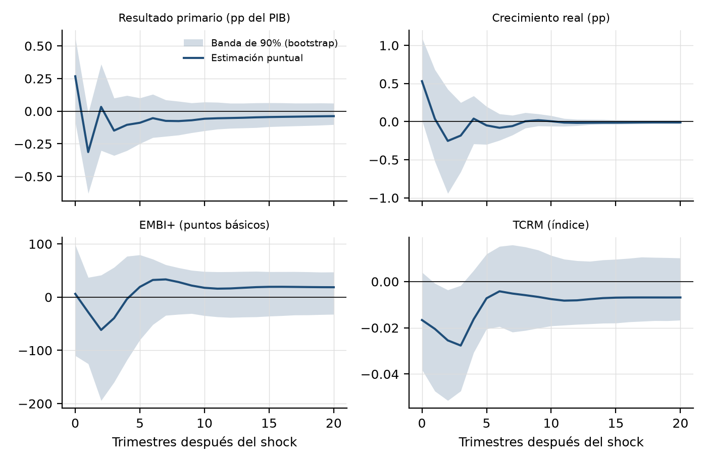
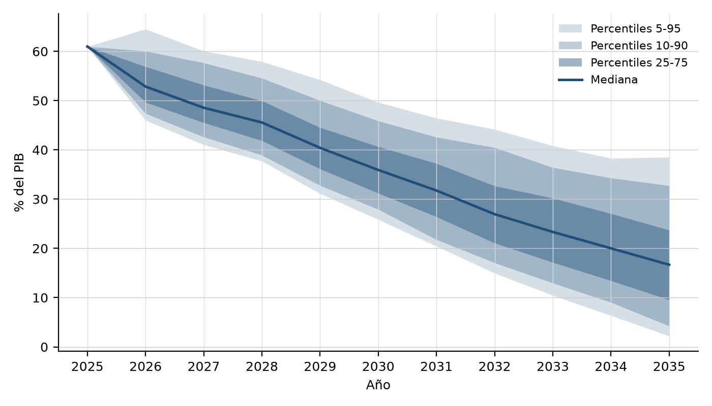
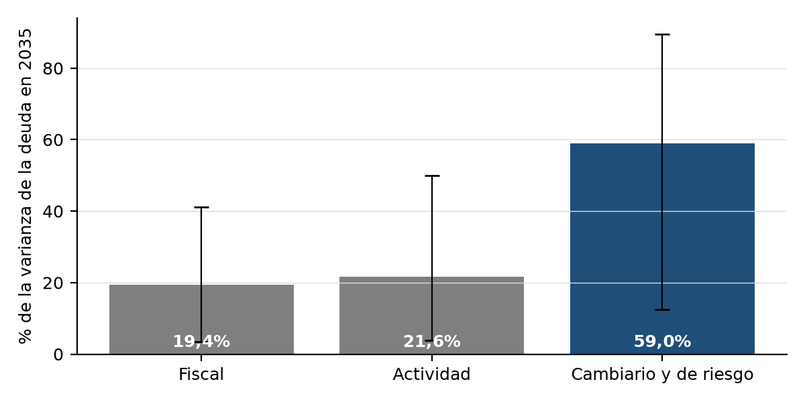

# 6. Resultados

Todos los resultados de este capítulo salen de la misma muestra efectiva, 1998T2-2025T4 (111 trimestres), y del mismo escenario base, el del análisis de sostenibilidad más reciente del FMI (2026), publicado con la consulta del Artículo IV y la segunda revisión del programa en mayo de 2026. La especificación principal usa la deuda consolidada neta con las Letras Intransferibles a valor nominal, que parte de 61,0% del PIB en diciembre de 2025. Las cifras se pueden reproducir con `codigo/modelos/fase24_svarx_1996_2025.py` y `codigo/modelos/fase25_simulacion_dsa_svarx.py`.

## 6.1 El SVARX estimado

**Propiedades de las series.** Las pruebas de raíz unitaria no clasifican con claridad la mayoría de las series: el resultado primario se comporta como una serie con raíz unitaria, el VIX como estacionaria, y en el resto ADF y KPSS no coinciden (Apéndice, sección A.1). Es lo esperable en series cortas con cambios de régimen, que es la razón por la que se estima el VAR en niveles. La prueba de Zivot y Andrews (1992) ubica el quiebre del tipo de cambio real en 2001T4, el mismo que encuentra el procedimiento de Bai y Perron (2003) para la deuda, que identifica tres quiebres (2001T4, 2006T2 y 2018T1). La prueba de Johansen no rechaza la ausencia de cointegración entre las variables en niveles.

**Rezagos y diagnósticos.** Con la regla de la sección 4.5, el modelo usa tres rezagos. La raíz de mayor módulo del polinomio característico es 0,96, de modo que el sistema es estable y tiene representación de medias móviles. La prueba de Portmanteau con 12 rezagos da un p-valor de 0,036: queda algo de autocorrelación en los residuos, que se informa como limitación. Los residuos no son normales (p < 0,001), lo que justifica remuestrear shocks históricos en lugar de suponer normalidad. La prueba ARCH-LM con cuatro rezagos no detecta heterocedasticidad condicional en ninguna ecuación (p-valores entre 0,87 y 0,99). El *bootstrap* salvaje es válido con y sin heterocedasticidad, así que su uso no depende de este resultado.

**Reacción fiscal.** El coeficiente de la deuda rezagada en la ecuación del resultado primario es 0,051 (p = 0,019), con un intervalo de 90% del *bootstrap* de [0,020; 0,082]. Diez puntos más de deuda en relación con el PIB se asocian, en promedio, con medio punto más de superávit primario. El resultado no depende del perímetro de la deuda:

| Serie de deuda | Rezagos | Reacción fiscal | Intervalo de 90% |
|---|---|---|---|
| Consolidada neta, Letras a valor nominal (principal) | 3 | 0,051 | [0,020; 0,082] |
| Consolidada neta, Letras a valor libros | 3 | 0,053 | [0,021; 0,085] |
| Consolidada bruta | 4 | 0,054 | [0,027; 0,079] |

El signo coincide con el que encuentran Celasun et al. (2006) en su panel de economías emergentes. La política fiscal argentina respondió a la deuda en el período, pero con un coeficiente chico. La simulación muestra si esa respuesta alcanza para estabilizarla.

**Retroalimentación de la deuda.** La deuda rezagada entra en las cuatro ecuaciones del sistema, de modo que la deuda responde a los shocks y a su vez los afecta (Favero y Giavazzi, 2007). El efecto más claro es sobre el riesgo país: un punto más de deuda en relación con el PIB eleva el EMBI+ del trimestre siguiente en 22 puntos básicos, con un intervalo de 90% del bootstrap de [11; 41]. El crecimiento también responde con signo positivo, [0,02; 0,12], y el tipo de cambio real no responde, [-0,002; 0,003]. Junto con la reacción fiscal, el sistema tiene así dos mecanismos que actúan en sentidos opuestos cuando la deuda sube: el riesgo país la encarece y el superávit primario la reduce.

**Respuesta a la tasa de la FED.** Un aumento de un desvío estándar en la tasa de política de la FED (0,50 puntos porcentuales) no produce respuestas sistemáticas de las variables domésticas (Figura 6.1). El EMBI+ sube 9 puntos básicos en el trimestre del shock, con un intervalo de 90% de [-83; 103], y 12 puntos básicos a los dos años, con un intervalo de [-14; 42]. De las 84 respuestas estimadas (cuatro variables en 21 horizontes), solo tres tienen una banda de 90% que excluye el cero: el crecimiento en el trimestre del shock (+0,5 puntos), el resultado primario un trimestre después (-0,35 puntos del PIB) y el tipo de cambio real tres trimestres después (una leve apreciación). Con bandas de 90%, el azar ya produciría unas ocho exclusiones aunque la FED no tuviera ningún efecto, y los signos del crecimiento y del tipo de cambio real son los contrarios a los que predice la teoría. Con 111 trimestres y un shock chico, el modelo no puede distinguir los efectos indirectos de la FED del ruido.

## 6.2 El gráfico de abanico

La Tabla 6.1 resume la distribución de la deuda simulada. La mediana baja de 61,0% del PIB en 2025 a 29,9% en 2030 y a 14,9% en 2035 (Figura 6.2). La caída la determina el escenario base del FMI (2026, cuadro 6). Ese escenario combina un superávit primario que sube de 1,4% del PIB en 2026 a 2,3% desde 2029 con una tasa de interés efectiva de entre 2,6% y 5,1%, mientras el deflactor del PIB pasa de 30,2% en 2026 a 7,5% desde 2029. Con esos supuestos, la tasa real que paga la deuda es muy negativa en los primeros años y la licua.

**Tabla 6.1. Deuda consolidada neta simulada (% del PIB), percentiles**

| Año | p5 | p25 | Mediana | p75 | p95 |
|---|---|---|---|---|---|
| 2026 | 42,7 | 46,0 | 48,8 | 52,4 | 59,5 |
| 2028 | 31,6 | 35,7 | 39,1 | 42,8 | 50,4 |
| 2030 | 20,0 | 25,2 | 29,9 | 34,6 | 42,9 |
| 2032 | 10,7 | 17,0 | 22,4 | 28,9 | 39,1 |
| 2035 | 0,3 | 7,6 | 14,9 | 22,5 | 37,1 |

El ancho del abanico entre los percentiles 5 y 95 es de 18,6 puntos en 2030, con un intervalo de 90% de [14,4; 23,3]. El del FMI para la deuda federal bruta es 71,5 (FMI, 2026, cuadro 7). El Capítulo 7 analiza esta diferencia.

## 6.3 Contraste de H1a

H1a sostiene que el superávit primario, por sí solo, no basta para estabilizar la deuda, porque la condicionan también el crecimiento, el tipo de cambio real y el riesgo país. El contraste compara la contribución de cada bloque de shocks a la varianza de la deuda simulada en 2035.

| Bloque de shocks | Participación en la varianza de la deuda en 2035 | Intervalo de 90% |
|---|---|---|
| Fiscal | 21,2% | [4,0; 43,3] |
| Actividad | 19,0% | [3,4; 45,2] |
| Cambiario y de riesgo (EMBI+ y TCRM) | 59,8% | [12,6; 90,0] |
| No fiscal menos fiscal (diferencia) | 57,7 puntos | [13,4; 92,0] |

Los shocks no fiscales explican cerca de cuatro quintos de la incertidumbre sobre la deuda en 2035, y el intervalo de la diferencia con el fiscal excluye el cero. **H1a queda respaldada en la especificación principal.** El bloque cambiario y de riesgo es el que más pesa. El resultado es coherente con la reacción fiscal positiva de la sección 6.1: el superávit responde a la deuda, pero la variabilidad de la deuda la dominan el tipo de cambio real y el riesgo país. La sección 6.6 muestra en qué especificaciones el resultado se mantiene y en cuáles no.

## 6.4 Contraste de H1b

El FMI (2026) estima una probabilidad de estabilización de alrededor de 99% en su abanico de mediano plazo (no estabilización de 1,0%, cuadro 7) y superior a 97% en su abanico de diez años, que termina en 2035. Cada horizonte se contrasta contra la cifra del FMI correspondiente.

| Horizonte | Probabilidad de no estabilización | Intervalo de 90% | Umbral del FMI | Criterio (límite inferior mayor que el umbral) |
|---|---|---|---|---|
| 2030 (cinco años) | 11,5% | [7,7; 15,2] | 1,0% | Se cumple |
| 2035 (diez años) | 6,6% | [3,3; 10,5] | menos de 3% | Se cumple |

A cinco años, la probabilidad de que la deuda consolidada no se estabilice es de 11,5%, más de diez veces el 1,0% del FMI, y el intervalo de 90% queda entero por encima de ese valor. A diez años baja a 6,6%, porque el escenario base sigue reduciendo la deuda y cada vez menos trayectorias terminan con la deuda en aumento. Aun así, el límite inferior (3,3%) supera el 3%, que es la cota que da el FMI para ese horizonte. **H1b queda respaldada en los dos horizontes.**

## 6.5 Contraste de H2

| Escenario | Diferencia en la probabilidad de no estabilización en 2035 | Diferencia en la deuda media en 2035 |
|---|---|---|
| Suba de un desvío estándar (0,50 pp) | +0,7 pp [0,0; 1,8] | +0,7 pp del PIB |
| Repetición del ciclo 2022-2023 (+5,25 pp en ocho trimestres) | +9,5 pp [3,7; 19,0] | +7,8 pp del PIB [1,9; 17,5] |

Entre corchetes, los intervalos de 90%.

Con un shock de un desvío estándar, el intervalo de la diferencia en la probabilidad toca el cero, de modo que no hay un efecto distinguible. Con una suba como la de 2022-2023, la probabilidad de no estabilización en 2035 sube 9,5 puntos y la deuda esperada, 7,8 puntos del PIB, y los dos intervalos excluyen el cero. **H2 queda respaldada para un endurecimiento de la magnitud del de 2022-2023, y no para un shock de un desvío estándar.**

Para saber por qué canal pasa el efecto, se repitió el escenario de 2022-2023 anulando la respuesta de las variables domésticas a la FED, de modo que solo actúa el mayor costo de refinanciar la deuda en dólares. Con los parámetros estimados, ese costo directo explica 5,1 de los 8,3 puntos de aumento de la deuda en 2035 (61%). El resto corresponde a la respuesta del riesgo país, el tipo de cambio real y el crecimiento, que en conjunto empujan en la misma dirección aunque, como se vio en la sección 6.1, ninguna de esas respuestas es significativa por separado.

## 6.6 Robustez

**Escenario base anterior del FMI.** Con el escenario de abril de 2025 (FMI, 2025, anexo II), que era el vigente cuando se planteó la investigación, la probabilidad de no estabilización es de 11,8% [8,0; 15,8] a cinco años y de 6,0% [3,0; 9,8] a diez, frente a 3,0% del FMI en ese informe. Las conclusiones no dependen de cuál de los dos escenarios del FMI se use.

**Perímetro de la deuda.** Con la deuda neta a valor libros y con la deuda bruta, la probabilidad de no estabilización a cinco años es de 12,7% y 12,3%, y a diez años, de 7,4% y 7,8%. En todos los casos los límites inferiores superan los umbrales del FMI. El efecto del ciclo 2022-2023 sobre la probabilidad a diez años es de 10,1 y 8,7 puntos, con intervalos que excluyen el cero. Para H1a la conclusión depende del perímetro. Con la deuda neta a valor libros se mantiene: los shocks no fiscales superan al fiscal por 58,5 puntos [16,6; 90,8]. Con la deuda bruta, en cambio, la diferencia es de 52,6 puntos, pero su intervalo, [-7,5; 93,7], incluye el cero.

**Identificación de los shocks.** La identificación principal descuenta del resultado primario su respuesta automática al ciclo (sección 4.4). Se la contrasta con dos ordenamientos de Cholesky, que imponen un orden de reacción contemporánea entre las variables:
- El primero (crecimiento, tipo de cambio real, EMBI+ y resultado primario) deja al shock fiscal en el último lugar: el resultado primario se ajusta en el mismo trimestre al ciclo y al riesgo, y no al revés. Con ese orden, la diferencia entre los shocks no fiscales y el fiscal es mayor que en la especificación principal: 78,5 puntos, con un intervalo de [34,7; 96,2].
- El orden inverso (resultado primario primero) le atribuye al shock fiscal toda la covarianza contemporánea con las demás variables. Es el ordenamiento más favorable a lo fiscal. Con él, la participación fiscal sube a 33,7% y la cambiaria y de riesgo queda en 59,9%. La diferencia sigue siendo positiva (32,6 puntos) y lo es en 77% de las réplicas, pero su intervalo, [-47,5; 87,4], incluye el cero.

La identificación no cambia la varianza total de la deuda simulada, de modo que H1b y H2 dan lo mismo con cualquiera de los tres esquemas. H1a, en cambio, depende de cómo se separa el shock fiscal: se sostiene con la identificación principal y con el orden que deja al shock fiscal último, y no con el que lo pone primero.

**Canal de tasas domésticas.** Si el riesgo país también encarece la deuda en pesos (sección 4.6), la probabilidad de no estabilización sube a 12,2% a cinco años y a 8,8% a diez. El bloque cambiario y de riesgo pasa a explicar 68,1% de la varianza de la deuda en 2035, y el efecto del ciclo 2022-2023 sube a 11,0 puntos de probabilidad.

**Sin retroalimentación de la deuda.** Si se anula el efecto de la deuda rezagada sobre las cuatro variables, la deuda se acumula por la identidad pero ya no realimenta al sistema. En ese caso, la probabilidad de no estabilización es de 11,5% a cinco años y de 6,1% a diez, el abanico se ensancha de 18,6 a 19,9 puntos y la diferencia entre los shocks no fiscales y el fiscal casi no cambia (57,9 puntos). Los dos mecanismos de la sección 6.1 se compensan: el aumento del riesgo país que provoca una deuda mayor queda contrarrestado por la respuesta del superávit. La retroalimentación importa para la forma de la dinámica, pero no cambia las conclusiones sobre las hipótesis.

**Shocks como los del FMI.** Con el procedimiento del abanico del FMI aplicado a las mismas series (sección 4.6), la probabilidad de no estabilización es de 23,0% a cinco años y de 15,2% a diez años, y el ancho del abanico en 2030 es de 82,8 puntos. Con la deuda bruta, las cifras son 24,6%, 17,3% y 104,1. Las dos formas de generar los shocks llevan a la misma conclusión sobre H1b. La del FMI da probabilidades y anchos mucho mayores.

**Tabla 6.2. Resumen de robustez de H1b**

| Especificación | No estabilización 2030 | No estabilización 2035 | Ancho del abanico 2030 |
|---|---|---|---|
| SVARX, deuda neta (principal) | 11,5% [7,7; 15,2] | 6,6% [3,3; 10,5] | 18,6 |
| SVARX, deuda neta a valor libros | 12,7% [8,8; 17,0] | 7,4% [3,8; 11,8] | 19,0 |
| SVARX, deuda bruta | 12,3% [8,5; 16,3] | 7,8% [4,5; 11,8] | 19,3 |
| SVARX, deuda neta con canal de tasas domésticas | 12,2% [8,5; 16,3] | 8,8% [4,3; 14,5] | 21,0 |
| SVARX, deuda neta sin retroalimentación de la deuda | 11,5% [7,8; 15,8] | 6,1% [3,3; 10,0] | 19,9 |
| SVARX, deuda neta, escenario del FMI de 2025 | 11,8% [8,0; 15,8] | 6,0% [3,0; 9,8] | 19,5 |
| Shocks a la manera del FMI, deuda neta | 23,0% | 15,2% | 82,8 |
| Shocks a la manera del FMI, deuda bruta | 24,6% | 17,3% | 104,1 |
| FMI (2026), deuda federal bruta | 1,0% | menos de 3% | 71,5 |

Entre corchetes, los intervalos de 90% del *bootstrap* de parámetros. Las filas a la manera del FMI no tienen intervalo porque ese procedimiento no estima parámetros.

La Figura 6.4 resume la tabla: en todas las especificaciones, la barra de 2030 y su intervalo quedan por encima del 1% del FMI, y la de 2035, por encima del 3%.

