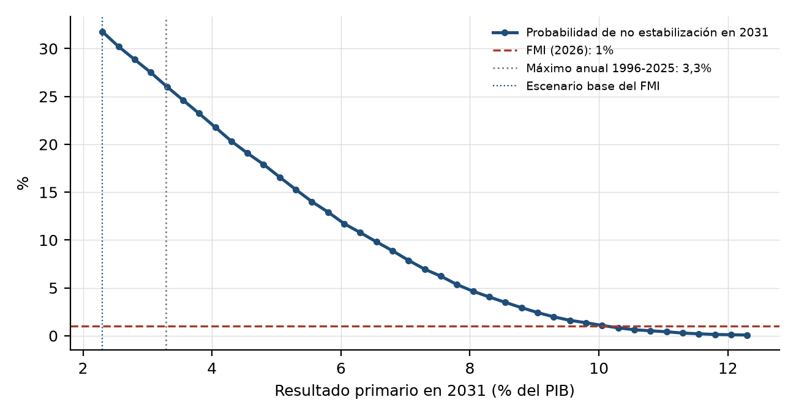

# 6. Resultados

Todos los resultados de este capítulo provienen de la misma muestra efectiva, 1998T2-2025T4 (111 trimestres), y del escenario base del análisis de sostenibilidad más reciente del FMI (2026). La especificación principal usa la deuda consolidada neta con las Letras Intransferibles a valor nominal, que parte de 61,0% del PIB en diciembre de 2025. Los intervalos son de 90% y salen del *bootstrap* descripto en la sección 4.5.

## 6.1 El SVARX estimado

**Propiedades de las series.** Las pruebas de raíz unitaria no clasifican con claridad la mayoría de las series: el resultado primario se comporta como una serie con raíz unitaria, el VIX como estacionaria, y en el resto ADF y KPSS no coinciden (Apéndice, sección A.2). Es lo esperable en series cortas con cambios de régimen (Perron, 1989), y es la razón por la que el VAR se estima en niveles. La prueba de Zivot y Andrews (1992) rechaza la raíz unitaria del TCRM cuando admite un quiebre, que ubica en 2001T4, el mismo trimestre que el primero de los tres quiebres que el procedimiento de Bai y Perron (2003) encuentra en la deuda (2001T4, 2006T2 y 2018T1). Para la propia deuda, en cambio, Zivot y Andrews ubican el quiebre en 2005T1 sin rechazar la raíz unitaria. La prueba de Johansen no rechaza la ausencia de cointegración entre las variables en niveles.

**Rezagos y diagnósticos.** El modelo usa tres rezagos (sección 4.5); el autovalor de mayor módulo de la matriz compañera es 0,96, de modo que el sistema es estable. La prueba de Portmanteau con 12 rezagos rechaza la ausencia de autocorrelación al 5% (p = 0,036). Los residuos no son normales (p < 0,001), lo que justifica remuestrear *shocks* históricos en lugar de suponer normalidad. La prueba ARCH-LM (Engle, 1982) con cuatro rezagos no detecta heterocedasticidad condicional en ninguna ecuación (p entre 0,87 y 0,99).

**Reacción fiscal.** El coeficiente de la deuda rezagada en la ecuación del resultado primario es 0,051, con un intervalo de [0,010; 0,103]. Diez puntos más de deuda en relación con el PIB se asocian, en promedio, con medio punto más de superávit primario. El resultado no depende del perímetro de la deuda (Tabla 6.1).

**Tabla 6.1. Reacción fiscal según la serie de deuda**

| Serie de deuda | Rezagos | Reacción fiscal | Intervalo de 90% |
|---|---|---|---|
| Consolidada neta, Letras a valor nominal (principal) | 3 | 0,051 | [0,010; 0,103] |
| Consolidada neta, Letras a valor libros | 3 | 0,053 | [0,012; 0,105] |
| Consolidada bruta (Tesoro y BCRA) | 4 | 0,054 | [0,023; 0,099] |
| Bruta del Tesoro, sin el BCRA | 4 | 0,057 | [0,024; 0,098] |

Fuente: elaboración propia.

El signo coincide con el que encuentran Celasun et al. (2006) en su panel de economías emergentes. Una reacción positiva es condición suficiente para la solvencia en el sentido de Bohn (2007), pero no dice si alcanza para estabilizar la deuda frente a los *shocks* que enfrenta; eso es lo que contrasta H1a.

**Retroalimentación de la deuda.** La deuda rezagada entra en las cuatro ecuaciones del sistema (Favero y Giavazzi, 2007). Además del superávit primario, la deuda se asocia con el crecimiento del trimestre siguiente, con un intervalo de [0,010; 0,141]. Con el riesgo país, la estimación puntual es de 22 puntos básicos por punto de deuda, pero el intervalo, [-0,1; 48,6], incluye el cero: con 111 trimestres no se puede afirmar que una deuda mayor eleve el EMBI+. Con el tipo de cambio real no hay relación.

**Respuesta a la tasa de la FED.** Un aumento de un desvío estándar en la tasa de política de la FED (0,50 puntos) no produce respuestas sistemáticas de las variables domésticas (Figura 6.1). El EMBI+ sube 6 puntos básicos en el trimestre del *shock*, con un intervalo de [-110; 98], y 28 puntos básicos a los dos años, con un intervalo de [-32; 55]. De las 84 respuestas estimadas (cuatro variables en 21 horizontes), cinco tienen una banda que excluye el cero: el crecimiento en el trimestre del *shock*, el resultado primario un trimestre después y el tipo de cambio real entre uno y tres trimestres después, que se aprecia levemente. Con bandas de 90%, el azar ya produciría unas ocho exclusiones aunque la FED no tuviera ningún efecto, y los signos del crecimiento y del tipo de cambio real son los contrarios a los que predice la teoría. Con 111 trimestres y un *shock* de magnitud acotada, el modelo no distingue los efectos indirectos de la FED del ruido.

## 6.2 El gráfico de abanico

La Tabla 6.2 resume la distribución de la deuda simulada (Figura 6.2). La mediana baja de 61,0% del PIB en 2025 a 39,5% en 2031 y a 29,9% en 2035, prácticamente la senda determinista del escenario base aplicada al punto de partida de esta tesis (40,2% y 30,3%). La caída la determina el escenario del FMI (2026, cuadro 6): un superávit primario que sube de 1,4% del PIB en 2026 a 2,3% desde 2029 y una tasa de interés efectiva de entre 2,6% y 5,1%, mientras el deflactor del PIB pasa de 30,2% en 2026 a 7,5% desde 2029. La inflación relativa, es decir, la valuación de la deuda en moneda extranjera por la depreciación nominal del escenario, suma en sentido contrario, sobre todo en 2026 y 2027.

**Tabla 6.2. Deuda consolidada neta simulada (% del PIB), percentiles**

| Año | p5 | p25 | Mediana | p75 | p95 |
|---|---|---|---|---|---|
| 2026 | 49,7 | 53,3 | 55,9 | 59,0 | 65,2 |
| 2028 | 39,6 | 45,4 | 49,7 | 54,7 | 63,3 |
| 2031 | 23,4 | 32,7 | 39,5 | 46,8 | 58,7 |
| 2033 | 15,0 | 26,2 | 34,7 | 43,9 | 58,5 |
| 2035 | 6,2 | 19,5 | 29,9 | 41,5 | 61,4 |

Fuente: elaboración propia. Estimación central, 20.000 trayectorias.

El ancho del abanico entre los percentiles 5 y 95 es de 35,3 puntos en 2031, con un intervalo de [19,1; 37,6]. El del FMI para la deuda federal bruta es 71,5 (FMI, 2026, cuadro 7). El Capítulo 7 analiza esta diferencia.

## 6.3 Contraste de H1a

H1a sostiene que el superávit primario, por sí solo, no basta para estabilizar la deuda, porque la condicionan también el crecimiento, el tipo de cambio real y el riesgo país.

**Suficiencia del superávit.** Con el superávit del escenario base (2,3% del PIB desde 2029), la probabilidad de que la deuda no se estabilice en 2031 es de 25,2%. La Figura 6.5 muestra cómo baja esa probabilidad a medida que se eleva el superávit primario de todos los años del escenario. Para llevarla al 1% que estima el FMI, el superávit de 2031 tendría que ser de 7,0% del PIB, el doble del máximo que alcanzó el Sector Público Nacional en 1996-2025 (3,6% en 2004). Aun con un superávit igual a ese máximo, la probabilidad de no estabilización sería de alrededor de 15%. **H1a queda respaldada:** ningún superávit dentro del rango observado en tres décadas lleva el riesgo al nivel que el FMI considera bajo.

**De dónde viene el riesgo.** La Tabla 6.3 descompone la varianza de la deuda simulada en 2035 según el bloque de *shocks* (Figura 6.3). En la estimación central, el bloque cambiario y de riesgo explica 58,7%, el fiscal 32,1% y el de actividad 9,3%. Los intervalos son amplios y se superponen: la diferencia entre los *shocks* no fiscales y el fiscal es de 35,9 puntos, pero su intervalo, [-4,8; 91,2], incluye el cero. La descomposición indica que el riesgo cambiario y de riesgo país es el componente más grande en la estimación central, pero no permite afirmar con el nivel de confianza fijado que domine al fiscal.

**Tabla 6.3. Participación de cada bloque de *shocks* en la varianza de la deuda en 2035**

| Bloque de *shocks* | Participación | Intervalo de 90% |
|---|---|---|
| Fiscal | 32,1% | [4,4; 52,4] |
| Actividad | 9,3% | [3,8; 43,1] |
| Cambiario y de riesgo (EMBI+ y TCRM) | 58,7% | [17,2; 86,0] |
| No fiscal menos fiscal (diferencia) | 35,9 puntos | [-4,8; 91,2] |

Fuente: elaboración propia.

## 6.4 Contraste de H1b

El FMI (2026) estima una probabilidad de estabilización de alrededor de 99% en su abanico de mediano plazo (no estabilización de 1,0%, cuadro 7) y superior a 97% en su abanico de diez años, que termina en 2035. Cada horizonte se contrasta contra la cifra del FMI correspondiente (Tabla 6.4).

**Tabla 6.4. Contraste de H1b**

| Horizonte | Probabilidad de no estabilización | Intervalo de 90% | Umbral del FMI | Criterio |
|---|---|---|---|---|
| 2031 (mediano plazo) | 25,2% | [19,0; 27,7] | 1,0% | Se cumple |
| 2035 (diez años) | 22,3% | [15,6; 24,9] | menos de 3% | Se cumple |

Fuente: elaboración propia. Error de Monte Carlo de la estimación central: 0,3 puntos en los dos horizontes.

En los dos horizontes, el intervalo queda entero muy por encima del umbral del FMI, y la conclusión se mantiene con la corrección de Bonferroni (límites inferiores de 2,5%: 18,0% y 14,6%). Con dos medidas alternativas el resultado es el mismo: si se usa el resultado primario simulado en lugar del previsto, la probabilidad en 2031 es de 29,2%, y la probabilidad de que la deuda de 2031 supere a la de 2029 es de 22,0%. **H1b queda respaldada en los dos horizontes.**

## 6.5 Contraste de H2

**Tabla 6.5. Efecto de la FED sobre la deuda en 2035**

| Escenario | Diferencia en la probabilidad de no estabilización | Diferencia en la deuda media |
|---|---|---|
| Suba de un desvío estándar (0,50 pp) | +1,5 pp [0,1; 3,1] | +1,0 pp del PIB [-0,1; 2,4] |
| Repetición de la senda de 2022-2025 | +13,0 pp [1,0; 24,8] | +7,8 pp del PIB [-1,4; 20,4] |

Fuente: elaboración propia.

En los dos escenarios, la suba de la tasa de la FED eleva la probabilidad de no estabilización en 2035 con un intervalo de 90% que excluye el cero, aunque por poco. El efecto sobre la deuda esperada tiene el signo previsto en los dos casos, pero sus intervalos incluyen el cero. Con la corrección de Bonferroni, ninguno de los efectos sobre la probabilidad se sostiene (límites inferiores de 2,5% de -0,1 y -0,2 puntos). **H2 queda respaldada de manera débil:** la dirección del efecto es la que plantea la hipótesis, pero su magnitud no se puede estimar con precisión.

Para saber por qué canal pasa el efecto, se repitió el escenario de 2022-2025 anulando la respuesta de las variables domésticas a la FED, de modo que solo actúa el mayor costo de refinanciar la deuda en dólares. Ese costo directo explica 4,7 de los 7,8 puntos de aumento de la deuda en 2035 (60%). El resto corresponde a la respuesta del riesgo país, el tipo de cambio real y el crecimiento, ninguna de ellas significativa por separado (sección 6.1). El efecto que la tesis puede atribuir a la FED pasa, entonces, sobre todo por el costo de la deuda en dólares, y no por los canales de riesgo, tipo de cambio y crecimiento que la hipótesis destaca.

## 6.6 Robustez

La Tabla 6.6 resume las 18 especificaciones alternativas.

**Tabla 6.6. Robustez**

| Especificación | No estabilización 2031 | No estabilización 2035 | Ancho del abanico 2031 | No fiscal menos fiscal (varianza) |
|---|---|---|---|---|
| Principal | 25,2% [19,0; 27,7] | 22,3% [15,6; 24,9] | 35,3 | 35,9 [-4,8; 91,2] |
| Deuda neta a valor libros | 26,5% [20,7; 28,8] | 23,9% [16,7; 25,6] | 37,5 | 23,0 [-11,5; 92,6] |
| Deuda bruta (Tesoro y BCRA) | 27,6% [22,0; 29,7] | 22,9% [16,7; 28,0] | 34,4 | 36,0 [-16,4; 89,3] |
| Deuda bruta del Tesoro, sin el BCRA | 27,3% [22,7; 30,1] | 23,5% [17,9; 27,6] | 33,5 | 31,5 [-17,1; 90,8] |
| Canal de tasas en pesos | 26,9% [20,1; 28,4] | 30,8% [17,2; 31,9] | 43,2 | 45,5 [-4,6; 93,5] |
| Sin retroalimentación de la deuda | 25,6% [19,1; 27,3] | 22,9% [14,1; 23,9] | 46,7 | 41,4 [-13,3; 90,7] |
| Dos rezagos | 27,4% [22,6; 31,1] | 27,9% [17,6; 31,2] | 45,5 | 49,6 [10,4; 89,9] |
| Cholesky, resultado primario primero (equivale a elasticidad cíclica 0) | 25,7% [19,2; 27,6] | 23,1% [15,0; 24,0] | 35,5 | 23,0 [-41,8; 82,3] |
| Cholesky, resultado primario último | 25,7% [19,1; 27,6] | 23,1% [14,8; 23,9] | 35,5 | 77,9 [20,6; 96,0] |
| Elasticidad cíclica 0,5 | 25,7% [19,4; 27,5] | 23,1% [15,4; 23,9] | 35,5 | 61,8 [38,2; 97,2] |
| Sin los shocks de 2001T4-2005T3 | 23,7% [16,8; 26,6] | 19,2% [12,8; 22,7] | 32,5 | 20,1 [-16,2; 87,5] |
| Muestra desde 2004 | 24,8% [14,4; 25,8] | 27,5% [10,4; 26,8] | 35,8 | -18,9 [-43,1; 91,9] |
| Resultado primario sin rentas de la propiedad | 23,4% [18,9; 27,8] | 19,6% [13,4; 22,2] | 22,9 | -12,2 [-50,7; 57,3] |
| Ajuste stock-flujo en cero | 22,0% [15,9; 24,1] | 18,9% [9,4; 20,6] | 33,4 | 27,8 [-15,0; 88,1] |
| λ = 0,15 | 25,6% [19,0; 27,5] | 20,7% [14,5; 23,4] | 32,4 | 31,6 [-6,9; 89,2] |
| λ = 0,40 | 25,8% [19,3; 27,5] | 24,9% [15,6; 25,6] | 37,8 | 38,0 [-3,4; 92,3] |
| Punto de partida 52,1% (deuda del FMI) | 22,8% [16,9; 24,7] | 20,9% [12,0; 21,9] | 34,0 | 30,2 [-12,1; 88,9] |
| Escenario del FMI de 2025 | 23,4% [17,1; 25,5] | 20,4% [13,1; 22,0] | 34,1 | 34,8 [-5,1; 89,9] |
| Shocks a la manera del FMI, deuda neta | 23,7% | 19,7% | 114,0 | no aplica |
| Shocks a la manera del FMI, deuda bruta | 24,6% | 21,3% | 143,2 | no aplica |
| FMI (2026), deuda federal bruta | 1,0% | menos de 3% | 71,5 | no aplica |

Fuente: elaboración propia. Entre corchetes, intervalos de 90%. Las filas a la manera del FMI no tienen intervalo porque ese procedimiento no estima parámetros. Con la muestra desde 2004 (82 trimestres), la estimación de 2035 queda por encima del intervalo: en 48 de las 200 réplicas la corrección del sesgo tuvo que reducirse para mantener la estabilidad, esas réplicas generan menos persistencia que la estimación central y el intervalo percentil se corre hacia abajo. El sesgo juega en contra de H1b, de modo que su límite inferior es conservador.

**H1b es robusta.** En todas las especificaciones, la probabilidad de no estabilización supera con holgura los umbrales del FMI en los dos horizontes. El valor más bajo, con el ajuste stock-flujo en cero, tiene un límite inferior de 9,4% en 2035. Partir de la deuda consolidada neta del FMI (52,1% del PIB), que descuenta las tenencias del FGS, apenas reduce la probabilidad (22,8% en 2031). Tampoco cambia el resultado restar del remuestreo los *shocks* del período de cesación de pagos y canje, usar el escenario del FMI de 2025 o medir solo la deuda del Tesoro.

**El perímetro no cambia los resultados.** Con la deuda bruta del Tesoro, sin el BCRA, las probabilidades (27,3% y 23,5%) son casi iguales a las de la deuda consolidada. El argumento de la sección 2.9, según el cual omitir al BCRA podía subestimar la sensibilidad de la deuda, no encuentra respaldo en la simulación: el aporte de la consolidación es de medición del nivel, no de la dinámica.

**La descomposición de la varianza no es robusta.** La diferencia entre los *shocks* no fiscales y el fiscal es positiva en la mayoría de las especificaciones, pero su intervalo solo excluye el cero con dos rezagos, con una elasticidad cíclica de 0,5 y con el ordenamiento de Cholesky que pone último al resultado primario. Se vuelve negativa con la muestra desde 2004 y con el resultado primario sin rentas de la propiedad. La identificación del *shock* fiscal determina cuánto de la varianza se le atribuye. Por eso el contraste de H1a descansa en la suficiencia del superávit (sección 6.3), que no depende de la identificación, y no en la descomposición.

**H2 es frágil.** El efecto de la senda de 2022-2025 sobre la probabilidad en 2035 excluye el cero en la mayoría de las especificaciones, pero no con el canal de tasas en pesos ni con el resultado primario sin rentas. El efecto sobre la deuda esperada no excluye el cero en ninguna.

La Figura 6.4 resume la tabla para H1b.

